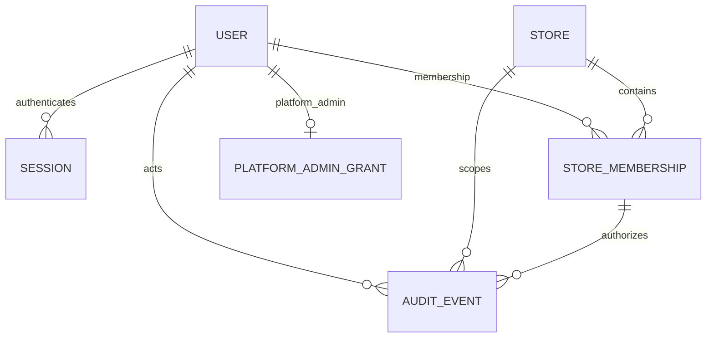
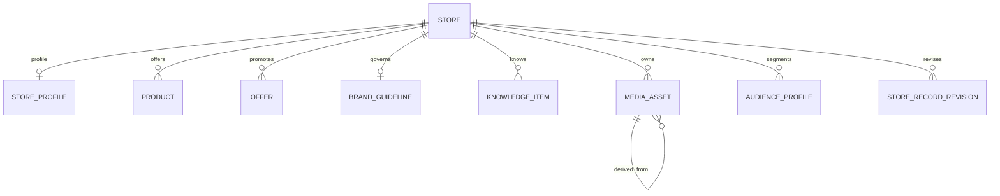
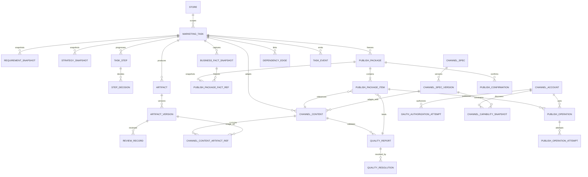
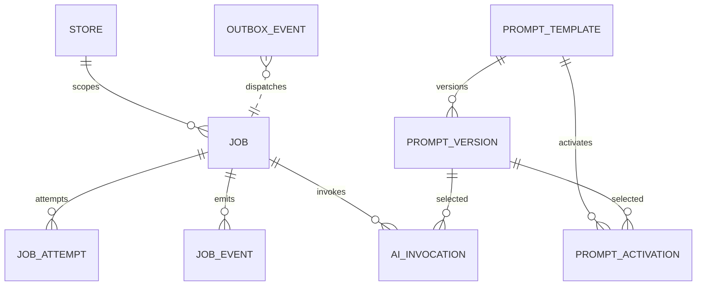

# 核心数据模型、API Schema 与事件 Schema v1

> 对应 Issue：#5–#10（跨域工程化准备）
> 状态：实现前评审草案；不是已冻结 OpenAPI、不是 Alembic 迁移，也不是代码实现声明
> 日期：2026-11-11
> 权威上位文档：`DOMAIN_INTEGRATION_CONTRACTS_V1.md`、`IDENTITY_STORE_SECURITY_DESIGN.md`、`MARKETING_TASK_DOMAIN_DESIGN.md`

## 1. 本文用途与决策纪律

本文把既有领域文档转成工程评审可以逐项核对的逻辑模型、API Schema 示例和事件 Envelope。不得跳过领域评审直接据此生成生产迁移。发生冲突时，先修订权威领域文档与审查记录，再更新本文。

当前仍未决：平台管理员主体存储/初始化；Session idle/absolute timeout；邀请/注册/密码重置流程；Offer 规则覆盖范围；上传安全策略；Job 调度阈值；Prompt 发布审批；首个渠道选择；owner/member 是否需要不同业务能力。本文不擅自关闭这些决策。

## 2. 全局类型与数据库约定

| 语义 | 逻辑类型 | 约束 |
|---|---|---|
| 主键/外键 | UUID | 门店业务表另有 `store_id UUID NOT NULL` |
| 时间 | TIMESTAMPTZ | 数据库存 UTC；API 使用 RFC 3339 offset-aware 时间 |
| 金额 | NUMERIC(12,2) + CHAR(3) | 禁止 float；币种不可缺省于金额 |
| 哈希/指纹 | CHAR(64) 或 BYTEA | SHA-256；编码约定全仓库统一 |
| 状态 | TEXT + CHECK 或 PostgreSQL ENUM | 全仓库选一种策略；状态值由领域文档定义 |
| 结构化扩展 | JSONB | 必须有 schema_version；核心关联字段不得藏入 JSONB |
| 逻辑删除 | archived_at / status | 不以物理删除破坏审计、版本和发布证据 |

所有门店子资源使用 `(store_id, id)` UNIQUE；子资源外键优先使用 `(store_id, parent_id)` 或更完整的复合外键。每条门店请求必须先构造 AuthorizedStoreContext，再访问业务对象。PostgreSQL RLS 是纵深防御，不替代应用授权。

## 3. 跨域逻辑 ERD

### 3.1 Identity 与 Store



核心约束：
- `users.email_normalized` UNIQUE；密码只存 Argon2id hash。
- `store_memberships(store_id,user_id)` UNIQUE；成员状态为 invited/active/suspended/removed。
- Session 只存 Token hash/verifier；不保存可绕过成员校验的 current_store_id。
- `X-Store-ID` 是请求的门店选择，不是授权凭证；每个请求实时验证 active Store + active StoreMembership。
- 平台管理员身份不得混入 StoreMembership.role，也不得默认读取门店业务内容。

### 3.2 Store Knowledge



- StoreProfile/BrandGuideline 一店一份时使用 UNIQUE(store_id)。
- Product 的 SKU 可空；非空时 UNIQUE(store_id, sku)。
- Offer 的有效期为 UTC；适用规则由 discriminated union Schema 校验。
- MediaAsset 是来源素材；不可被营销生成物覆盖。对象 key 不公开，只由授权服务签发短时 URL。

### 3.3 Marketing Orchestrator 与 Content



- MarketingTask 是业务聚合根；Artifact/Review/ChannelContent/QualityReport/Package 由 #8 持有，Job/Outbox 由 #9 持有。
- RequirementSnapshot、StrategySnapshot、BusinessFactSnapshot、ArtifactVersion、ReviewRecord、ChannelContent、QualityReport、QualityResolution、PublishPackage、PublishPackageFactRef、PublishPackageItem、PublishConfirmation 均按不可变记录处理。
- 文案与图片审核分别按 artifact_type/version 绑定；审核旧版本不能批准新版本。
- 一个 PublishPackage 聚合一次任务交付，至少包含一条 PackageItem 和一条 #7 BusinessFactSnapshot 引用；PublishPackageItem 每个渠道一条；冻结/确认以整个 package fingerprint 为单位。
- BusinessFactSnapshot 由 #7 MarketingTask 持有，记录任务实际使用的事实快照；其来源版本追溯到 #6 StoreRecordRevision。#8 不直接拥有或重写 #6 事实版本。
- QualityReport 只记录自动/规则质检结果；needs_human 的人工决定写入独立追加式 QualityResolution。hard fail 不可覆盖。
- PublishConfirmation 不可变，首期不提供撤销；若未来允许撤销，使用独立追加式记录，不更新确认行。
- 依赖边记录上游版本 ID + fingerprint；失效只沿真实依赖闭包传播。
- 发布确认必须绑定冻结包的确切 fingerprint。

### 3.4 Job Runtime 与 AI



- PostgreSQL 是 Job/Attempt/Outbox 状态事实源；Celery + Redis 仅提供至少一次投递。
- Job 状态按 PR #20 的待评审契约统一为 queued/running/retry_wait/succeeded/failed/needs_human/cancelled；Job 不单独使用 dead。OutboxEvent 可使用 dead 表示投递耗尽，不能映射为 Job 状态。
- AIInvocation 与 Job 状态独立；PromptVersion 必须固定不可变版本引用。
- PromptTemplate/PromptVersion/PromptActivation 是全局平台配置，不含 store_id；平台管理员写权限由 #5 授权，不能因此读取门店经营数据。PromptVersion 发布后不可变，回滚追加 PromptActivation。
- AIInvocation 字段扩展建议（待 #9 联合评审）：provider_request_id 与 usage_json，用于供应商对账和分项计费；未批准前不视为冻结字段。
- 发布超时等外部副作用结果不确定时进入 needs_human，对账前禁止盲目重发。

### 3.5 Prompt 管理（#10）

PromptTemplate/PromptVersion/PromptActivation 是全局平台配置，不含 store_id；平台管理员写权限由 #5 capability 授权，不能因此读取门店业务数据。

- PromptTemplate：`id, template_key, display_name, industry_key, task_type, capability, description, status(active|archived), current_published_version_id, created_by_user_id, created_at, updated_at`；UNIQUE(industry_key, task_type, capability, template_key)。
- PromptVersion：`id, prompt_template_id, version_no, system_prompt, user_prompt_template, variables_schema_json, output_schema_json, schema_version, input_policy_json, changelog, status(draft|published), created_by_user_id, created_at, published_by_user_id, published_at`；UNIQUE(prompt_template_id, version_no)。Draft 可编辑，published 不可 UPDATE/DELETE。
- PromptActivation：`id, prompt_template_id, activated_version_id, previous_version_id, action(publish|rollback), reason, actor_user_id, created_at, idempotency_record_id`；追加写，必须引用同一模板的 published 版本。
- Prompt rollback 只改变 PromptTemplate.current_published_version_id 并追加 PromptActivation；不修改 PromptVersion 历史。
- AIInvocation.prompt_version_id 固定引用实际 PromptVersion；历史调用不得读取当前模板指针。

AIInvocation 扩展建议（待 #9 联合评审）：nullable `provider_request_id` 与 `usage_json`，用于供应商任务对账和分项 usage/成本复算；未批准前不视为冻结字段。

### 3.6 Channel Integration（#12）

- ChannelAccount（门店级）：id、store_id、channel_key、external_account_id、display_name、authorization_status、granted_scopes_json、access_token_secret_ref、refresh_token_secret_ref、token_expires_at、authorized_by_user_id、authorized_at、last_verified_at、version。Token 不存明文。
- OAuthAuthorizationAttempt：store_id、channel_key、requested_by_user_id、state_hash、nonce、pkce_verifier_secret_ref、redirect_uri_key、expires_at、consumed_at；state 单次使用且短 TTL。
- ChannelSpec/ChannelSpecVersion（全局无 store_id）：ChannelSpec 持有 channel_key/current_version_id；ChannelSpecVersion 保存 spec_version、文本/媒体/标签/链接/排期约束、draft/publish capability、官方来源证据；版本不可变。
- ChannelCapabilitySnapshot（门店账号级）：store_id、channel_account_id、channel_spec_version_id、capability_key、support_status、evidence_ref、checked_at、expires_at；必须绑定确切规格版本，unsupported/pending_verification 不得伪装已接通。
- PublishOperation：store_id、publish_package_id、package_item_id、package_fingerprint、channel_account_id、action(save_draft|publish)、status(requested|queued|submitting|processing|draft_saved|published|failed|needs_human|cancelled)、idempotency_key、request_fingerprint、external_request_id、external_post_id、external_url、response_evidence_ref、error_code、timestamps。
- PublishOperationAttempt：publish_operation_id、attempt_no、adapter_version、request_fingerprint、external_request_id、response_evidence_ref、normalized_status、error_code、retryable、timestamps。与 #9 JobAttempt 分离。

PublishOperation.published 必须有 external_post_id 或等价平台证据；Job succeeded 只代表 Worker 执行完成。manual_handoff 不创建 PublishOperation。ChannelAccount/PublishOperation 均为 store-scoped；ChannelSpecVersion 是平台级全局配置。

## 4. API 通用约定

### 4.1 请求头

| Header | 要求 | 语义 |
|---|---|---|
| Cookie | 门店 API 必须 | HttpOnly Session；不允许 localStorage Token |
| X-Store-ID | 门店作用域 API 必须 | 选择当前门店；服务端校验成员关系 |
| Idempotency-Key | 所有有副作用 POST 必须 | 同一作用域同一 key + 同一 request hash 返回原结果；不同 hash 返回 409 |
| If-Match / expected_version | 更新聚合根必须 | 乐观并发控制；过期版本返回 409 |
| X-CSRF-Token | Cookie Session 写请求必须 | Session 绑定 synchronizer token |
| X-Request-Id | 可选输入 | 服务端生成或规范化，贯穿日志与事件 |

### 4.2 标准错误响应

```json
{
  "code": "VERSION_CONFLICT",
  "message": "The resource has changed. Reload and retry.",
  "request_id": "req_01J...",
  "details": {
    "expected_version": 4,
    "current_version": 5
  }
}
```

| HTTP | code 示例 | 规则 |
|---|---|---|
| 400 | STORE_CONTEXT_REQUIRED | 缺少 X-Store-ID |
| 401 | AUTH_REQUIRED / SESSION_EXPIRED | 未认证或 Session 无效 |
| 403 | ACTION_FORBIDDEN | 已认证但无动作能力 |
| 404 | RESOURCE_NOT_FOUND | 不存在或不属于当前门店，统一语义 |
| 409 | VERSION_CONFLICT / IDEMPOTENCY_KEY_REUSED | 并发冲突或幂等键被不同请求复用 |
| 422 | VALIDATION_ERROR | Schema/业务规则不合法 |
| 429 | RATE_LIMITED | 触发限流 |
| 5xx | INTERNAL_ERROR | 不向客户端泄露堆栈、Secret 或厂商原始异常 |

## 5. 核心 API Schema 示例

以下为逻辑 Schema 示例。最终 Pydantic 模型和 OpenAPI 由对应 API 模块生成，不允许人工维护两份互相漂移的事实源。

### 5.1 创建营销任务

```json
{
  "task_type": "full_marketing",
  "title": "周末新品推广",
  "requirement": {
    "goal": "提升新品到店体验",
    "product_ids": ["2f9d6a2e-0000-4000-8000-000000000001"],
    "audience": "周边家庭客群",
    "channels": ["wechat_official_account"],
    "desired_publish_at": "2026-11-14T02:00:00Z"
  }
}
```

规则：
- 请求体不接受 store_id、created_by、role、capabilities；门店和操作者由 AuthorizedStoreContext 注入。
- 返回 201，包含 task id、lifecycle_status、version、当前步骤摘要和 created_at。
- 重复 Idempotency-Key + 相同请求体返回同一资源；相同 key + 不同请求体返回 409。

### 5.2 确认需求/策略（统一并发语义）

```json
{
  "expected_version": 3,
  "decision": "confirm",
  "payload": {
    "goal": "提升新品到店体验",
    "audience": "周边家庭客群",
    "key_messages": ["新品特点以已确认商品资料为准"]
  },
  "reason": null
}
```

规则：
- 服务端校验当前 task.version；确认后追加不可变 Snapshot，不覆盖历史。
- 若上游资料/版本在确认过程中变化，必须重算 fingerprint 并要求重新确认，不得沿用旧确认。
- 返回新 task.version 与 snapshot_id。

### 5.3 审核指定产物版本

```json
{
  "review_type": "copy",
  "artifact_version_id": "7e8c9a10-0000-4000-8000-000000000002",
  "decision": "revision_requested",
  "comment": "首句需要更明确的新品利益点",
  "target": {
    "kind": "text_range",
    "start": 0,
    "end": 18
  }
}
```

规则：
- review_type 必须与 Artifact.artifact_type 一致；copy 与 image 审核独立。
- ReviewRecord 绑定精确 artifact_version_id；旧版本审核不能作用于新版本。
- 通过审核的版本一旦生成新版本，新版本必须重新审核。

### 5.3.1 质检人工复核决议

```json
{
  "decision": "accepted",
  "reason": "已人工核验该软性风险，不涉及事实错误或平台硬性限制",
  "expected_fingerprint": "bbbbbbbbbbbbbbbbbbbbbbbbbbbbbbbbbbbbbbbbbbbbbbbbbbbbbbbbbbbbbbbb"
}
```

规则：
- 仅 `QualityReport.result=needs_human` 可追加 QualityResolution。
- `accepted` 才允许该报告参与冻结；`rejected` 继续阻断。
- `fail` 是 hard fail，不允许人工覆盖；修正输入后重新运行质检。
- 决议记录绑定 reviewer_user_id、reason 和原报告 fingerprint，追加写且幂等。

### 5.4 冻结发布包与最终确认

```json
{
  "expected_task_version": 8,
  "fact_snapshot_ids": ["7e8c9a10-0000-4000-8000-000000000010"],
  "items": [
    {
      "channel_key": "wechat_official_account",
      "channel_content_id": "7e8c9a10-0000-4000-8000-000000000006",
      "quality_report_id": "7e8c9a10-0000-4000-8000-000000000005",
      "channel_account_id": "7e8c9a10-0000-4000-8000-000000000007",
      "delivery_mode": "official_api",
      "planned_publish_at": null
    },
    {
      "channel_key": "douyin",
      "channel_content_id": "7e8c9a10-0000-4000-8000-000000000008",
      "quality_report_id": "7e8c9a10-0000-4000-8000-000000000011",
      "channel_account_id": null,
      "delivery_mode": "manual_handoff",
      "planned_publish_at": null
    }
  ]
}
```

规则：
- Freeze 时逐项重新校验审核、渠道规格、事实快照、质检指纹和所有版本归属；items[] 必须至少一项且 channel_key 不重复。
- 一个 PublishPackage 聚合多个 PublishPackageItem；冻结包与所有 items 在同一事务写入，不允许部分冻结。
- 冻结包不可变；最终确认只接受 package_id + package_fingerprint，任一上游变化产生新包，旧确认不继承。
- official_api item 必须绑定 #12 已授权 ChannelAccount；manual_handoff item 不得伪造发布成功。
- 发布请求只接受已确认的包；#8 为每个 official_api item 创建受控命令，#12 渠道 Adapter 执行外部副作用。

### 5.5 Job 人工恢复/处理

```json
{
  "expected_version": 6,
  "action": "retry",
  "reason": "已核实上游服务恢复"
}
```

规则：
- retry/cancel/resolve 均需授权、审计和 Idempotency-Key。
- resolve 仅适用于 needs_human，必须记录核验结果与操作者。
- 对外发布不确定结果必须先查证渠道端状态，不得直接 retry。

## 6. 事件 Envelope 与示例

所有跨域事件采用版本化 envelope：

```json
{
  "event_id": "0b2f4f2a-0000-4000-8000-000000000001",
  "event_type": "marketing_task.snapshot_changed",
  "schema_version": 1,
  "occurred_at": "2026-11-11T02:30:00Z",
  "store_id": "2f9d6a2e-0000-4000-8000-000000000001",
  "aggregate": {
    "type": "marketing_task",
    "id": "7e8c9a10-0000-4000-8000-000000000001",
    "version": 4
  },
  "correlation_id": "req_01J...",
  "causation_id": "0b2f4f2a-0000-4000-8000-000000000000",
  "actor": {
    "type": "user",
    "id": "7e8c9a10-0000-4000-8000-000000000010"
  },
  "data": {
    "snapshot_type": "requirement",
    "snapshot_id": "7e8c9a10-0000-4000-8000-000000000011",
    "content_fingerprint": "aaaaaaaaaaaaaaaaaaaaaaaaaaaaaaaaaaaaaaaaaaaaaaaaaaaaaaaaaaaaaaaa"
  }
}
```

事件规则：
- Outbox 与业务写入同一数据库事务；投递失败可重试。
- 消费者按 event_id 幂等；事件重复、乱序均不得导致状态倒退。
- 消费者处理前校验 aggregate.version 和 fingerprint；旧版本事件不得覆盖新状态。
- payload 只放必要引用/状态/摘要；不放 Cookie、Token、Secret、原始敏感 Prompt 或大文件。
- schema_version 变化必须兼容性评审；破坏性变更使用新版本或新 event_type。

## 7. 状态/并发/幂等的数据库约束清单

1. 聚合根 `version > 0`；更新使用 `WHERE id=? AND store_id=? AND version=?`，成功后 version + 1。
2. 幂等记录唯一键至少包含 `store_id, actor_scope, operation, idempotency_key`；actor_scope 必须允许 user 与 system 分离。
3. 快照序号唯一：`UNIQUE(store_id, task_id, snapshot_no)`。
4. 产物版本唯一：`UNIQUE(store_id, artifact_id, version_no)`。
5. 审核记录只追加；审核必须 FK 到精确 artifact_version。
6. 依赖边需支持上游与下游两个方向索引；同一版本依赖边唯一。
7. Job 尝试唯一：`UNIQUE(job_id, attempt_no)`；租约领取用原子 UPDATE/SELECT FOR UPDATE SKIP LOCKED。
8. Outbox 消费端持久化 event_id 去重；Relay 通过租约/锁避免并发重复 claim。
9. PublishPackage、PublishPackageFactRef 与 PublishPackageItem 冻结后禁止 UPDATE；PublishConfirmation 为不可变记录并绑定整个 package fingerprint，首期不提供撤销。
10. PublishPackageFactRef 以 (store_id,publish_package_id,business_fact_snapshot_id) 唯一，并复合 FK 到 #7 任务级 BusinessFactSnapshot；该快照来源追溯至 #6 已确认 StoreRecordRevision。
11. UNIQUE(store_id, publish_package_id, channel_key)；PackageItem 复合 FK 校验 channel_key 与 ChannelContent 一致，并保证 QualityReport 属于同一 ChannelContent，所有复合 FK 包含 store_id。
12. ChannelContent.copy_version_id 使用 store_id 复合 FK；ChannelContentArtifactRef 以 (store_id, channel_content_id, position) 唯一，并对 ChannelContent/ArtifactVersion 使用包含 store_id 的复合 FK；图片数组仅是 API projection。
13. 一个 PublishPackage 至少有一个 PackageItem 和一个已确认 BusinessFactSnapshot 引用；manual_handoff 时 channel_account_id 允许 NULL，official_api 时必须非 NULL。
14. PublishOperation（#12）对外副作用前先持久化幂等键和 attempt；未知结果进入 needs_human。
15. 所有复合外键包含 store_id；禁止只凭全局 UUID 跨门店引用。
16. 时间窗口、Offer 有效期统一 UTC 存储，展示按 Store.timezone 解释。
17. QualityResolution 复合 FK 到同店 QualityReport，保存 quality_report_fingerprint；UNIQUE(store_id, quality_report_id, quality_report_fingerprint)，写入时校验报告 result=needs_human，并通过 idempotency_record_id 防重复。
18. PublishConfirmation 以 (store_id,publish_package_id,package_fingerprint) 唯一；首期不提供撤销，确认记录不可 UPDATE/DELETE。
19. PromptTemplate UNIQUE(industry_key, task_type, capability, template_key)；PromptVersion UNIQUE(prompt_template_id, version_no)，published 版本不可 UPDATE/DELETE。
20. PromptActivation 追加写并按 idempotency_record_id 去重；只能引用同一 PromptTemplate 的 published PromptVersion。
21. AIInvocation.prompt_version_id 必须引用精确 PromptVersion；历史调用不得动态读取 PromptTemplate.current_published_version_id。
22. PromptTemplate.current_published_version_id 通过复合 FK 校验 PromptVersion 属于同一模板；PromptActivation 的 activated_version_id/previous_version_id 也必须属于该模板且为 published 版本。
23. ChannelAccount UNIQUE(store_id, channel_key, external_account_id)；所有 ChannelAccount/Capability/Operation 复合 FK 必须同 store。
24. OAuthAuthorizationAttempt.state_hash UNIQUE、expires_at 必须有效、consumed_at 只允许从 NULL 单向设置；不得存 state/code 原文。
25. ChannelSpecVersion UNIQUE(channel_spec_id, spec_version)，发布后不可 UPDATE/DELETE；ChannelCapabilitySnapshot 引用精确 channel_spec_version_id。
26. PublishOperation UNIQUE(store_id, package_item_id, channel_account_id, action, package_fingerprint)；idempotency_key 唯一，且复合 FK 到同店 PublishPackage/PackageItem/ChannelAccount。
27. PublishOperationAttempt UNIQUE(publish_operation_id, attempt_no)，外部请求证据按受控引用保存。
28. PublishOperation.status=published 时必须有 external_post_id 或平台等价成功证据；draft_saved 必须有平台草稿证据。
29. ChannelSpec UNIQUE(channel_key)；ChannelSpecVersion UNIQUE(channel_spec_id,spec_version)，current_version_id 通过复合 FK 指向同一 ChannelSpec 的不可变版本。
30. ChannelCapabilitySnapshot 复合 FK 到同店 ChannelAccount 和 ChannelSpecVersion；历史能力快照禁止覆盖。
31. ChannelContent.channel_spec_version_id 必须 FK 到精确 ChannelSpecVersion；PublishPackage/PackageItem 冻结时将其纳入 item/package fingerprint。

## 8. 必须补齐的实现前 Schema 工件

| 工件 | Owner | 退出条件 |
|---|---|---|
| Pydantic request/response models + OpenAPI snapshot | #4/API 各模块 | Schema 可生成、diff 可审查 |
| SQLAlchemy models + Alembic migrations | #5–#9 各数据 owner | PostgreSQL 干净库 upgrade/downgrade 或明确不可逆策略通过 |
| Event JSON Schema | #7–#10 | schema_version、兼容策略、契约测试齐全 |
| Provider request/result Pydantic models | #9/#10 | Text/Image/Vision/OCR 正常与错误响应测试 |
| DB constraint integration tests | #5–#9 | 复合 FK、唯一键、并发、租约在真实 PostgreSQL 验证 |
| API contract tests | #4/#5–#10 | OpenAPI snapshot、错误码、幂等、If-Match 语义验证 |

## 9. 评审门禁与当前未完成项

- [ ] B/C/D 联合评审签字：表归属、跨域 FK、状态机和事件消费者。
- [ ] #5 决议：平台管理员主体、Session timeout、邀请/重置流程、owner/member 能力映射。
- [ ] #6 决议：Offer union 覆盖面、素材上传限制/扫描/保留。
- [ ] #7/#8 决议：任务步骤与产物版本的精确依赖关系、审核/质检阻断策略。
- [ ] #9 决议：Job lease/retry/sweeper 阈值、Outbox relay 调度与告警。
- [ ] #10 决议：PromptVersion 发布/回滚权限、Provider 错误归一化。
- [ ] 生成正式 OpenAPI 与 JSON Schema，不以本草案代替。
- [ ] 生成 ERD 物理表/复合 FK/索引清单，并通过 PostgreSQL 迁移测试。
- [ ] 自动化契约测试、跨店安全测试、幂等/并发/恢复测试。
- [ ] 关联 Demo 路由和页面验收矩阵，确保接口与真实产品流程对应。

**状态声明：** 本文完成的是文档层工程化准备。没有修改业务代码，没有生成或执行数据库迁移，没有生成正式 OpenAPI，没有执行测试；因此不代表任何生产能力已实现或测试通过。


## 9. Identity / Store Knowledge / Job Runtime 最新映射（PR #26/#27/#29 已合并）

- Identity 的成员实体统一称 StoreMembership；PlatformAdminGrant 是独立平台管理员授权，不是 StoreMembership。
- 每个门店 API 使用 X-Store-ID 不可信 selector；AuthContext.request_store_id 由服务端逐请求校验后产生。Session.active_store_id 仅作 UI 默认选择。
- Store Knowledge 增加 AudienceProfile 与 StoreRecordRevision 的领域设计，具体字段和事实确认规则以 STORE_KNOWLEDGE_DOMAIN_DESIGN.md 为准。
- 用户触发 Job 的 store_id / created_by_user_id 从 AuthorizedStoreContext 注入；系统 Job 使用显式 system scope 与 actor_type=system。
- Job 状态按已合并的 PR #29 异步运行时契约执行：Job 使用 queued/running/retry_wait/succeeded/failed/needs_human/cancelled；OutboxEvent 的投递耗尽状态独立管理，不得映射为 Job 状态。PR #26（身份）、#27（门店资料）、#29（异步运行时）已合并进入 main；PR #25（营销任务）亦已合并。上述 PR 只完成设计文档，不代表生产实现、迁移或测试通过。
