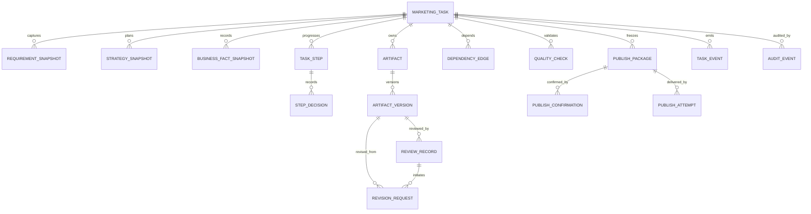

# 营销任务领域设计与规则冻结

> 文档类型：Issue #7 设计准备 / 领域规则基线  
> 对应产品基线：`PRODUCT_DESIGN.md v1.8`  
> 对应架构基线：`TECHNICAL_ARCHITECTURE.md`（模块化单体 + 独立 Worker）  
> 状态：设计提案，待领域评审冻结；不是生产实现声明  
> 日期：2026-11-11

## 1. 目标与边界

营销任务是一次按需营销执行的业务聚合根。它承载需求、策略、经营事实确认、文案与图片交付物、渠道适配、质检、商家最终确认、发布与异常恢复的可追溯过程。

本设计落实产品文档既有规则，不新增 ERP、CRM、POS、广告投放、通用工作流编排或独立工单能力。固定营销流程由领域状态机和应用服务控制；Worker 只执行异步操作，不拥有营销任务业务状态。

核心不变量：

1. 所有业务对象均归属一个 `store_id`，服务端从认证上下文确认门店权限。
2. 任务业务状态、阶段状态、审核状态、异步 Job 状态彼此独立。
3. 需求、策略、经营事实、产物和发布包采用不可变版本；修改创建新版本。
4. 文案审核与图片审核独立，审核结论绑定具体产物版本。
5. 仅受依赖影响的下游对象失效；禁止全任务无差别重置。
6. 适用的商家确认/审核门槛不能通过直接 API、重试或前端状态绕过。
7. 任务完成不等于经营效果完成；发布结果不确定时不得标记发布成功。
8. 所有状态变更、跳过、审核、恢复和外部副作用均可追溯。

## 2. 领域对象与数据所有权

| 对象 | 职责与关键字段 |
|---|---|
| MarketingTask | 聚合根；id、store_id、task_type、lifecycle_status、current_requirement_snapshot_id、current_strategy_snapshot_id、version、created_by、timestamps |
| RequirementSnapshot | 不可变需求快照；目标、任务类型、商品/服务引用、客群、活动意图、渠道、期望时间、上下文引用、确认状态、内容指纹 |
| StrategySnapshot | 不可变策略快照；目标、受众、主题、卖点、渠道策略、热点采纳/跳过决策、关键事实引用、确认人/时间、指纹 |
| BusinessFactSnapshot | 本任务使用的关键事实值、来源对象/版本、商家确认状态、确认人/时间；价格、折扣、库存、有效期等不得由模型臆造 |
| TaskStep | 固定流程节点实例；step_key、status、applicability、skip_reason、input_fingerprint、output_refs、block_reason、started_at、finished_at |
| StepDecision | 节点采纳/跳过/继续等决策；决策人、原因、依据快照、时间 |
| Artifact / ArtifactVersion | 文案、图片、渠道变体等逻辑产物及不可变版本；version_no、source_type、source_refs、instruction、content_hash、provider metadata、created_by |
| ReviewRecord | 文案或图片的独立审核记录；artifact_type、artifact_version_id、decision、reviewer、comment、target/region、time |
| RevisionRequest | 针对某一版本的整改意见；目标段落/图片区域、指令、状态、对应新版本 |
| DependencyEdge | 上游对象版本/指纹到下游产物的依赖边；dependency_type、impact_policy、observed_fingerprint |
| PublishPackage | 冻结的渠道交付快照；引用确切文案/图片/渠道版本、质检结果、事实版本和指纹 |
| PublishConfirmation | 商家针对确切 PublishPackage 的最终确认；确认人、时间、确认内容指纹 |
| TaskEvent / AuditEvent | 追加式业务事件与安全审计；操作者、主体、门店、来源、关联对象、前后状态、原因、请求 ID |
| Job / JobAttempt / JobEvent | 异步执行状态、租约、重试、执行日志；不替代 MarketingTask 或 TaskStep 状态 |

### 2.1 聚合边界

MarketingTask 是流程协调聚合根，但大文件只保存对象存储引用。文案、图片、审核和发布包由 #8 Content/Media/Publishing 管理；Job/Attempt/Outbox 由 #9 Job Runtime 管理；营销任务只保存其 ID、版本和指纹引用，通过应用服务/领域事件协调，不直接修改其内部数据表。

所有写操作在事务中校验 `store_id`、当前版本、状态迁移和前置条件。跨模块事件通过 Outbox 或等价可靠机制投递。

## 2.2 任务类型与节点适用矩阵

任务类型是创建时确定的业务意图，可在需求确认前修正；需求确认后变更任务类型视为需求快照变更，必须重新计算节点适用性和依赖。

| 任务类型 | 需求/上下文 | 热点机会 | 策略确认 | 文案审核 | 图片审核 | 渠道适配 | 质检 | 最终确认/交付 |
|---|---|---|---|---|---|---|---|---|
| 完整营销 | 必须 | 适用时决策；不适用记录原因 | 必须 | 有文案时必须 | 有图片时必须 | 选定渠道时必须 | 必须 | 交付前必须 |
| 纯文案 | 必须读取相关事实 | 默认不适用并记录 | 轻策略/内容方向确认；无需完整营销策略 | 必须 | 不适用 | 按需 | 渠道交付时必须 | 对外交付前必须 |
| 纯图片 | 必须读取商品/品牌事实和素材 | 不适用 | 图片目标/视觉方向确认 | 不适用 | 必须 | 按需 | 图片事实/画面检查必须 | 对外交付前必须 |
| 原图优化 | 原图、权属/来源、改造范围必须 | 不适用 | 改造目标确认 | 不适用 | 必须 | 按需 | 图片事实/画面检查必须 | 对外交付前必须 |
| 商家自有内容 | 来源、事实与用途必须确认 | 按用途适用 | 依任务用途决定 | 上传文案适用时必须 | 上传图片适用时必须 | 按需 | 对外发布/交付时必须 | 对外交付前必须 |

矩阵规则：
- “不适用”由服务端根据 task_type 与实际交付范围判定，写入 TaskStep.applicability 和系统跳过原因；不是让商家任意跳过。
- “按需”必须在需求/策略快照中记录是否需要及原因；一旦选择渠道交付，该渠道的规格检查不能跳过。
- 纯文案/纯图片任务可以不经过另一类产物审核，但不得把缺失的产物伪装为已审核。
- 商家自有文案/图片仍创建 ArtifactVersion，并进入对应审核状态机；来源类型为 merchant_upload。
- 任一任务如包含正式渠道发布，必须执行适用的商家审核、质检、最终确认和发布门禁。

## 3. 三层状态模型

### 3.1 MarketingTask 生命周期

| 状态 | 含义 | 允许的后续状态 |
|---|---|---|
| draft | 任务已创建，尚未启动执行 | active、cancelled |
| active | 存在可执行阶段 | waiting_for_user、blocked、failed、completed、cancelled |
| waiting_for_user | 等待需求/策略/审核/最终确认等商家动作 | active、cancelled |
| blocked | 缺少前置数据、权限或外部能力，暂不可推进 | active、cancelled |
| failed | 任务级不可自动恢复失败；保留现场 | active（显式恢复）、cancelled |
| completed | 本任务适用交付流程已完成；发布可为草稿或已发布 | archived |
| cancelled | 商家/授权操作者取消；保留历史 | archived |
| archived | 归档只读状态 | 无 |

说明：
- 局部节点失败不自动把任务置为 failed；任务可保持 active，并将具体 TaskStep 标记 failed。
- `waiting_for_user` 是聚合视图状态。商家完成待办后任务回到 active。
- `completed` 代表任务交付流程完成，不代表产生经营效果。
- 归档不删除数据、不改变审核/发布事实。取消后如需继续，应复制为新任务，避免重开已取消的业务事实。

### 3.2 TaskStep 阶段状态

固定节点按任务类型配置适用性，建议节点键：

`requirement_understanding` → `context_snapshot` → `opportunity_decision`（适用时）→ `strategy_confirmation` → `copy_production_review`（适用时）→ `image_production_review`（适用时）→ `channel_adaptation`（适用时）→ `quality_check` → `final_confirmation` → `delivery`。

阶段状态统一为：

| 状态 | 含义 |
|---|---|
| pending | 尚未开始且前置条件未全部满足 |
| running | 当前执行中 |
| waiting_for_user | 等待商家输入、确认或审核 |
| succeeded | 节点已成功完成 |
| failed | 节点执行失败，可按规则重试/恢复 |
| skipped | 经规则判定不适用或商家明确跳过，并保存原因 |
| stale | 输入依赖已变化，原结果不可继续使用 |

规则：
- `skipped` 必须有 `applicability=not_applicable` 或经允许的明确跳过决策；记录 skip_reason、actor、时间和依据。适用的商家审核节点不得跳过。
- `stale` 不等于失败。重新执行产生新输出版本，历史输出保留。
- 只有前置节点满足条件且输入指纹匹配时，节点才可从 pending 进入 running。
- 阶段的成功不代表整个任务成功；任务状态由服务端根据全部适用节点和交付条件计算。

### 3.3 文案与图片独立审核状态机

文案和图片各自拥有审核对象与状态，不存在共享的 `content_approval` 字段。

| 状态 | 含义 |
|---|---|
| draft | 草稿，未提交审核 |
| generating | 生成/整改执行中 |
| waiting_for_review | 当前版本等待商家审核 |
| revision_requested | 商家要求修改，当前版本未通过 |
| revising | 正在根据意见产生新版本 |
| approved | 当前确切版本已通过 |

| rejected | 当前版本被拒绝，不可进入交付 |
| stale | 依赖已变化，当前审核结论不能用于当前交付 |

状态规则：
- AI 生成、商家上传、手动编辑、AI 整改均创建新 ArtifactVersion。
- 审核通过只对 `artifact_version_id` 有效。新版本创建后，新版本状态为 waiting_for_review 或 replaced_by_merchant；旧版本审核记录保留，但不能替代新版本审核。
- `revision_requested` 不等于 approved。整改失败不改变上一版本的历史审核结果。
- 图片整改不重置文案审核；文案修改只使真实引用该文案事实/文字的图片变 stale 或待复核。
- 一组图片按明确的审核单元分别记录；不得用其中一张通过代表整组通过。
- 商家自有内容同样需要来源记录与适用审核，不因上传而自动通过；上传来源记录在 ArtifactVersion.source_type，审核生命周期仍从 waiting_for_review 开始。

## 4. 合法迁移与服务端门禁

所有迁移由领域服务/应用服务执行，前端只展示服务端返回的状态、可执行动作和阻断原因。

关键门禁：

| 目标动作 | 必须满足 |
|---|---|
| 确认策略 | 当前需求快照存在；必填经营事实已由商家确认；热点节点已采纳或记录跳过原因（若适用） |
| 开始文案生产 | 策略已确认；文案任务适用；所需事实/品牌上下文可用 |
| 提交文案审核 | 当前文案版本存在且生成/导入完成 |
| 开始依赖文案的图片生产 | 引用的文案版本已 approved；或产品规则明确该图片类型不依赖文案 |
| 提交图片审核 | 当前图片版本及源素材引用完整 |
| 渠道适配 | 所需文案、图片的确切版本均 approved；不适用的产物有显式跳过记录 |
| 质检通过 | 渠道版本、事实版本、产物审核版本均与当前指纹一致；所有硬性检查通过 |
| 冻结发布包 | 质检通过；引用版本全部新鲜且不可变 |
| 最终确认 | 商家确认主体有权操作，且确认对象是当前 PublishPackage 的精确指纹 |
| 发布/提交草稿 | 最终确认有效；发布幂等键已建立；渠道账号授权与能力可用 |
| 标记发布成功 | 有平台回执/作品 ID 或可核验成功证据；仅请求发出不算成功 |

阻断返回结构至少包含 `code`、`message`、`blocked_by[]`、`required_action`、`current_version`。不能只返回笼统 400。

## 5. 需求/策略快照与版本规则

1. 需求首次确认生成 RequirementSnapshot v1；每次影响任务目标、商品、客群、活动、渠道或执行范围的有效修改生成新快照。
2. 策略确认生成 StrategySnapshot；重新制定/修改策略生成新版本，旧策略与旧确认记录保留。
3. 快照中记录引用的门店资料对象 ID、版本/更新时间、来源、字段确认状态和内容指纹；不能只保存一个会随资料变化的外键。
4. 任务创建时固定提示词模板版本、模型/Provider 选择策略及关键上下文引用，便于复现；敏感密钥只保存 secret reference。
5. 只有确认后的快照可作为后续阶段正式输入。草稿编辑不改变已确认快照；用户明确保存并重新确认后切换当前快照。
6. 当前快照变化时触发依赖图计算，标记受影响的下游 TaskStep/Artifact/ChannelVariant/QualityCheck 为 stale；未受影响的历史产物和审核记录保留。
7. 历史任务展示必须能还原当时输入和产物，不得动态读取最新门店资料覆盖历史上下文。

## 6. 依赖图与失效策略

依赖以版本 ID + 内容指纹表达，不仅依赖更新时间。每个下游产物声明其真实输入集合。

| 上游变化 | 应失效的对象 | 不应自动失效 |
|---|---|---|
| 需求目标/商品/客群/活动范围变化 | 相关策略、文案、图片、渠道变体、质检、发布包和最终确认 | 与变化无关且可证明不依赖该字段的产物 |
| 策略主题/卖点/渠道/优惠变化 | 引用对应策略字段的文案；引用文案/策略的图片；渠道变体、质检、发布包、最终确认 | 不依赖变化字段的独立图片/文案 |
| 关键价格/库存/有效期事实变化 | 使用该事实的文案/图片/渠道版本、事实检查、质检、发布包、最终确认 | 未引用该事实的产物 |
| 文案新版本 | 依赖该文案版本的图片（仅当含文字/卖点/活动事实）、相关渠道文案/组合包、质检、发布包、最终确认 | 图片本身不含文案信息且无语义依赖时；其他文案版本 |
| 图片新版本 | 引用该图片的渠道素材、画面检查、质检、发布包、最终确认 | 文案版本及其审核状态 |
| 渠道规格/账号能力变化 | 受影响渠道变体、渠道专项质检、发布包、最终确认 | 其他渠道版本及原始文案/图片 |
| 质检规则版本变化 | 受规则影响的质检结果、发布包和最终确认 | 原始产物与审核记录 |

实现约束：
- DependencyEdge 记录 `upstream_type/id/version/fingerprint`、`downstream_type/id/version`、`impact_policy`。
- 新产物生成时写入完整依赖清单及指纹；执行前再次比对。
- stale 传播按有向无环依赖图做受影响闭包计算，并按 impact_policy 过滤；禁止简单地把所有后续步骤重置。
- stale 后旧产物可查看/恢复为新分支版本，但恢复动作本身创建新版本并重新校验依赖，不能把旧审核直接移植到新版本。
- 发布包冻结后不可编辑；任何输入变化均需新建发布包并重新最终确认。

## 7. 异常恢复与任务执行

### 7.1 Job 与业务状态分离

Job 状态由 Issue #9 Job Runtime 唯一拥有，采用 `queued`、`running`、`retry_wait`、`succeeded`、`failed`、`cancelled`、`needs_human`。营销领域不得定义 `dead` 等第二套 Job 状态；Outbox 投递状态由异步运行时独立管理。

- TaskStep 描述业务节点是否完成；Job 描述某次异步执行尝试。Job 状态枚举与迁移只引用 Issue #9 契约，营销域不得复制或扩展。
- 一个 TaskStep 可以对应多个 Job；一次 Job 成功也必须经过业务结果校验后才能推进 TaskStep。
- Worker 崩溃或租约过期时，Job 可被重新领取；不可直接把 TaskStep 假定成功。
- 重试只重跑失败的执行单元；已成功的独立产物不重复生成。
- 非幂等外部动作（尤其发布）结果不确定时进入 needs_human，先查询/核验外部状态，禁止盲目重发。

### 7.2 幂等与重复提交

- 所有用户写 API 接受 `Idempotency-Key`；唯一范围为 `store_id + actor_id + operation + idempotency_key`，保存 request_hash、结果资源 ID 和响应状态。同一作用域/Key/Hash 重放返回原结果；相同 Key、不同 Hash 返回 409。Job Runtime 使用由应用服务派生的稳定 Job 幂等键，并与内部 event_id/job_id 消费幂等边界区分。
- 保存请求体 hash、业务对象 ID、处理结果和状态；相同 key + 相同请求返回原结果，相同 key + 不同请求体返回 409。
- 生成类 Job 的幂等键由 task、stage、输入指纹、操作类型和请求轮次组成。
- 发布幂等键必须绑定 PublishPackage ID、渠道账号 ID 和发布动作；禁止客户端重试生成新 key 造成重复发布。
- 重复点击/网络重放不产生重复版本、重复审核记录或重复外部副作用。

### 7.3 并发控制

- MarketingTask 使用整数 `version` 乐观锁；更新需传 `If-Match` 或 `expected_version`。
- 数据更新采用 `UPDATE ... WHERE id=? AND version=?`；影响行数为 0 返回 409 Conflict，并返回最新版本号与冲突字段摘要。
- 对同一 Artifact 的审核/整改采用版本级并发控制；审核时必须提交 artifact_version_id，不能审核“最新版本”模糊指针。
- 同一阶段的重复 Worker 通过租约/claim token 防止同时提交结果；结果落库需校验当前输入指纹仍一致。
- 用户在旧版本上提交意见时，服务端提示版本已变化，要求刷新并明确重新选择目标版本，不静默覆盖。

### 7.4 失败恢复策略

| 故障 | 处理 |
|---|---|
| Provider 限流/暂时不可用 | 指数退避 + 抖动；超过上限转 failed/dead，保留可恢复上下文 |
| 模型输出结构/事实校验失败 | 记录失败原因；按安全策略有限重试或等待人工处理，不写入正式版本 |
| Worker 进程中断 | 租约过期后重新排队；以幂等键防重复写入 |
| 对象存储上传失败 | 产物标记未完成，不允许审核/发布；可重传并校验 hash |
| 数据库成功、消息投递失败 | Outbox 重发，消费者幂等 |
| 用户取消任务 | 取消未开始/可取消 Job；已发生外部副作用需核验并记录，不能伪造回滚 |
| 发布请求超时/连接断开 | Job 标记 needs_human；按平台查询能力核验是否已发布，再决定恢复 |
| 版本依赖变化导致 Worker 迟到 | 拒绝将结果挂到当前版本；保留 attempt 记录，必要时存为孤立候选结果供人工检查 |

## 8. 事件与审计

建议领域事件：

- `marketing_task.created / activated / waiting_for_user / blocked / completed / cancelled / archived`
- `requirement.snapshot_created / requirement.confirmed`
- `strategy.snapshot_created / strategy.confirmed`
- `task_step.started / succeeded / failed / skipped / stale`
- `copy.version_created / copy.review_requested / copy.revision_requested / copy.approved`
- `image.version_created / image.review_requested / image.revision_requested / image.approved`
- `artifact.marked_stale`
- `publish_package.frozen / publish.confirmed / publish.requested / publish.completed / publish.failed / publish.needs_human`
- `job.queued / job.claimed / job.retry_scheduled / job.failed / job.recovered`

事件至少包含 event_id、task_id、store_id、aggregate_version、event_type、actor_type/id、correlation_id、causation_id、occurred_at、payload schema version。事件与审计日志追加写入，不以覆盖更新替代历史。

## 9. API 契约草案

所有接口在认证上下文内解析当前门店；禁止信任请求体的 store_id 作为授权依据。

| 方法 | 路径 | 用途 |
|---|---|---|
| POST | /api/v1/marketing-tasks | 创建任务与初始需求草稿 |
| GET | /api/v1/marketing-tasks | 当前门店任务列表/筛选 |
| GET | /api/v1/marketing-tasks/{task_id} | 任务详情、步骤、待办与版本摘要 |
| PATCH | /api/v1/marketing-tasks/{task_id}/requirement | 保存需求草稿（乐观锁） |
| POST | /api/v1/marketing-tasks/{task_id}/requirement/confirm | 生成并确认需求快照 |
| POST | /api/v1/marketing-tasks/{task_id}/strategy/confirm | 确认策略快照 |
| POST | /api/v1/marketing-tasks/{task_id}/steps/{step_key}/skip | 提交允许的跳过决策与原因 |
| POST | /api/v1/marketing-tasks/{task_id}/artifacts/{artifact_id}/reviews | 针对明确版本提交审核结论/意见 |
| POST | /api/v1/marketing-tasks/{task_id}/artifacts/{artifact_id}/revisions | 创建整改请求与异步 Job |
| POST | /api/v1/marketing-tasks/{task_id}/publish-packages | 校验并冻结发布包 |
| POST | /api/v1/marketing-tasks/{task_id}/publish-packages/{package_id}/confirm | 商家最终确认 |
| POST | /api/v1/marketing-tasks/{task_id}/publish-packages/{package_id}/deliver | 创建发布/草稿 Job |
| POST | /api/v1/marketing-tasks/{task_id}/recover | 对失败节点进行显式恢复 |
| POST | /api/v1/marketing-tasks/{task_id}/cancel | 取消任务 |
| POST | /api/v1/marketing-tasks/{task_id}/archive | 归档任务 |

写接口统一支持 Idempotency-Key；并发更新支持 expected_version/If-Match。API 返回 task lifecycle、task version、各 step 状态、文案审核状态、图片审核状态、当前版本 ID、stale 原因、blocked_by 和 pending_actions。审核接口必须明确传入 artifact_version_id。

## 10. 数据库约束建议

- 核心业务表均含 `id`、`store_id`、`created_at`；按数据敏感度含 created_by。
- `marketing_tasks(store_id,id)` 建复合唯一约束，子表用复合外键保证同门店引用。
- RequirementSnapshot、StrategySnapshot、ArtifactVersion、ReviewRecord、TaskEvent、AuditEvent、PublishPackage 采用只追加/不可变策略；数据库权限或触发器禁止覆盖核心历史字段。
- ReviewRecord 必须外键引用 ArtifactVersion；唯一约束避免同一请求重复写审核动作。
- 当前版本指针可更新，但历史版本记录不可变。
- `idempotency_records` 对作用域 + key 建唯一索引；保留请求 hash 与响应引用。
- Job 的 claim/lease 字段与业务表分离；Outbox 事件有唯一 event_id。
- 软删除不用于版本、审核、发布、事件等审计事实；任务归档使用状态。
- 时间戳统一 UTC 存储；API 按用户/门店时区展示。

## 11. 验收测试矩阵

| ID | 场景 | 预期 |
|---|---|---|
| DOM-01 | 合法主流程迁移 | 每步服务端校验成功，状态和事件一致 |
| DOM-02 | 未确认需求/策略直接调用下游 API | 拒绝并返回明确 blocked_by |
| DOM-03 | 纯文案/纯图片/原图优化等不同任务类型 | 不适用节点显式 skipped，适用审核不可跳过 |
| DOM-04 | 文案通过后整改产生新版本 | 新版本待审；旧版本及旧审核可追溯，不自动沿用 |
| DOM-05 | 图片整改 | 图片新版本重新审核；文案 approved 保持 |
| DOM-06 | 文案改动但图片不引用其文字/卖点 | 不误使无依赖图片失效 |
| DOM-07 | 文案改动影响图片内文字/优惠事实 | 仅相关图片、渠道组合和质检 stale |
| DOM-08 | 图片变化 | 相关渠道素材、画面质检及发布包 stale；文案不变 |
| DOM-09 | 价格/有效期事实变化 | 引用该事实的产物与发布包 stale；无关产物保留 |
| DOM-10 | 旧审核意见提交到新版本 | 拒绝或要求显式选择目标版本 |
| DOM-11 | 同幂等键重复创建/审核/发布 | 返回原结果，不产生重复副作用 |
| DOM-12 | 相同幂等键不同请求体 | 409 |
| DOM-13 | 两个客户端同时更新任务 | 一个成功，另一个 409；无静默覆盖 |
| DOM-14 | Worker 租约过期后重复执行 | 结果幂等，无重复产物/扣费/发布 |
| DOM-15 | Worker 完成时输入指纹已变化 | 迟到结果不推进当前节点 |
| DOM-16 | 发布请求超时、平台结果未知 | needs_human；核验前不可重发 |
| DOM-17 | 刷新/重启/消息重复投递 | 从持久化状态恢复，业务状态不漂移 |
| DOM-18 | 跨门店 task/artifact/version IDOR | 404/403，不泄露其他门店数据 |
| DOM-19 | 任务归档后写操作 | 拒绝修改，历史查询可用 |
| DOM-20 | 任务 completed 后经营效果尚无数据 | 任务完成保持；效果模块显示待采集/空状态 |

## 12. 设计冻结门槛与未决项

本设计可以作为 Issue #7 的设计评审输入；以下项目需在进入实现前完成：

1. 评审本文件的生命周期状态和任务类型适用节点矩阵。
2. 与轨道 B 的 Store/Member/Session 授权契约对齐；任务接口只接受服务端解析出的门店上下文。
3. 与工程底座确认 ORM、迁移、Outbox、Celery/Redis、对象存储实现细节，不在本领域设计中擅自新增基础设施。
4. 明确每类任务（完整营销、纯文案、纯图片、原图优化、自有内容）的节点适用性配置。
5. 将本文件状态从“设计提案”改为“已冻结”前，需产品/技术评审确认；本文件不代表已完成数据库迁移、API 或生产代码。
6. 实现阶段补齐状态迁移、依赖失效、审核隔离、幂等、并发、权限、Worker 恢复与发布不确定性测试，并更新 Demo 验收矩阵。

## 13. 与 Identity & Store（轨道 B）的集成契约

> 本节依据产品基线、技术架构和 Issue #5 的身份/门店安全设计定义营销任务域必须遵守的消费契约。Issue #5 的 request-scoped X-Store-ID / AuthorizedStoreContext 契约仍待联合评审冻结；实现时以最终合并版本为准。

### 14.1 请求身份与门店上下文

- 请求主体由认证中间件解析为可信的 `actor_id`、`session_id`、`actor_type`；不得从请求体或普通 Header 信任 user_id、role、store_id。
- 每个门店业务请求通过 `X-Store-ID` 提交 request-scoped store selector；它是不可信输入，不是授权凭据。服务端逐请求验证 Session、Store 状态和 StoreMembership，并构造 `AuthorizedStoreContext.request_store_id`。Session.active_store_id 仅作 UI 默认门店提示，不作为请求授权上下文。
- 营销任务 API 的应用服务接收显式 `AuthorizedStoreContext`（概念契约：store_id、actor_id、membership_id、权限能力/授权版本）；该上下文只能由认证/授权层构造，业务模块不得自行解析客户端身份声明。
- 创建任务时 `store_id` 从 AuthorizedStoreContext 注入；忽略或拒绝请求体中的 store_id。更新、审核、恢复、归档、发布等动作均再次执行资源门店归属和操作权限校验。
- 权限至少区分：可查看任务、可编辑需求/策略、可审核文案、可审核图片、可最终确认/发布、可恢复/取消任务。具体角色映射由轨道 B 定义；营销域只依赖能力判定，不创建独立 RBAC 管理后台。

### 14.2 资源归属与数据库约束

- MarketingTask、RequirementSnapshot、StrategySnapshot、TaskStep、Artifact、ArtifactVersion、ReviewRecord、PublishPackage、PublishConfirmation、TaskEvent、AuditEvent、Job 等门店业务记录均保存 `store_id`。
- 任务内子资源引用使用复合唯一键/外键（如 `(store_id, task_id)`、`(store_id, artifact_id)`），避免跨门店 ID 被合法外键误关联。
- 读取资源时采用门店范围查询；不能先按全局 ID 读取对象再依赖前端隐藏。资源不存在与资源属于其他门店时按统一安全策略返回 404，避免泄露对象存在性。
- 对象存储元数据必须保存 store_id、asset_id、version_id 和访问策略；下载/上传签名 URL 只能由已授权服务端短时签发，不能因猜中 object key 获得访问权。
- PostgreSQL RLS 可作为纵深防御，但不能替代应用层授权；连接池事务必须可靠设置并清理门店上下文，防止上下文串用。

### 14.3 异步 Job 的身份与授权边界

- Job 创建时持久化 `store_id`、`marketing_task_id`、触发者 actor_id、操作类型、输入版本/指纹和 correlation_id；Worker 不接受客户端身份参数。
- Worker 领取 Job 后，必须重新验证 task、artifact、version、asset 的 store_id 一致性和任务当前状态；执行完成写回前再次检查当前依赖指纹和业务版本。
- 用户被移出门店、门店停用或权限撤销后，新的用户请求立即按轨道 B 的 Session/成员关系撤销策略拒绝。已排队 Job 的处置策略由动作风险决定：未开始的用户触发 Job 默认取消或转 needs_human；已经开始的只读/可安全计算 Job 可按策略完成但不得产生未经授权的外部副作用；发布类 Job 必须在真正发起外部副作用前重新验证门店状态、渠道授权和发布确认有效性。
- Job 的 service identity 仅用于执行受托操作，不可扩大为跨门店访问权限；所有读取仍以 Job 绑定的 store_id 限定。

### 14.4 审计与授权撤销

- 营销域记录 task_id、store_id、actor_id、actor_type、membership/authorization reference、动作、目标版本、结果、原因、request_id、时间；密钥、Session Token 和敏感内容不得写入日志。
- 成员加入/移除、门店停用、角色/能力变更由 Identity & Store 域产生权威审计事件；营销域可消费必要的撤销/失效事件以取消待执行动作，但不复制一套成员关系真相。
- 审核和最终确认必须记录实际操作者；系统/Worker 代执行不得伪装成商家本人确认。

### 14.5 轨道 B 对齐验收

| ID | 场景 | 营销域预期 |
|---|---|---|
| SEC-MKT-01 | 请求体伪造 store_id 创建任务 | 忽略或拒绝伪造值；只写入授权上下文门店 |
| SEC-MKT-02 | 将 task_id 替换为其他门店任务 | 统一 404/拒绝，不泄露存在性 |
| SEC-MKT-03 | 将 artifact/version/review/package ID 跨门店替换 | 任何读写/审核/发布均被拒绝 |
| SEC-MKT-04 | 用户切换到非成员门店 | 门店上下文解析失败，不执行任务操作 |
| SEC-MKT-05 | 成员被移除后继续审核/恢复任务 | 请求按撤销后的授权状态失败 |
| SEC-MKT-06 | Job 的 task_id 与 store_id 不匹配 | Worker 拒绝执行并记录安全事件 |
| SEC-MKT-07 | 任务门店停用时触发发布 | 外部副作用前阻断，进入安全失败/人工处理 |
| SEC-MKT-08 | 未授权访问对象存储版本 | 不签发可访问 URL；旧 URL 按既定有效期/撤销策略控制 |
| SEC-MKT-09 | 门店 A 的授权上下文在连接池复用到门店 B | 事务结束清理上下文，RLS/应用层均不串店 |
| SEC-MKT-10 | 平台管理员访问门店任务 | 仅按产品定义的管理权限允许，不因平台管理员身份默认获得全部经营内容访问权 |

## 14. 与现行基线的关系

- 产品流程与审核门槛遵循 `PRODUCT_DESIGN.md v1.8`，本文件不得与之冲突。
- 模块边界、异步执行、Outbox、Job 与业务状态分离遵循 `TECHNICAL_ARCHITECTURE.md`。
- UI 只呈现后端状态、阻断原因和下一步动作；不得在前端自行推导业务迁移。
- 当前 Demo 的本地状态仅为交互基准，不是服务端领域实现或生产级隔离证明。

## 15. 字段级逻辑数据模型（待轨道 B/D 对齐，不是迁移脚本）

> 本节用于冻结营销域的数据语义与引用关系。字段类型采用 PostgreSQL 逻辑类型表达；具体 ORM 命名、UUID 生成策略、JSONB 拆分、Identity 外键目标及 Job/Outbox 物理表归属，须在轨道 B/D 契约评审后确定。不得据此直接生成生产迁移。

### 15.1 通用约定

- 主键统一使用 UUID（逻辑类型 uuid）；所有时间统一 timestamptz UTC。
- 所有门店业务表包含 store_id uuid NOT NULL；由服务端授权上下文注入，不接受客户端决定。
- 门店内资源采用 (store_id, id) 复合唯一键；子表优先使用复合外键，保证引用对象属于同一门店。
- 不可变快照/版本/审核/事件/发布确认采用追加写；修正通过新记录表达。
- 状态字段使用受约束的 text 或 PostgreSQL enum（二选一由工程底座统一）；状态值必须与本文件状态机一致。
- JSONB 仅承载有版本号的结构化快照/Provider 原始元数据，不用 JSONB 隐藏需要关联、过滤或唯一约束的核心字段。
- created_by_actor_id、reviewer_actor_id 等身份引用暂定为 UUID；实际 FK 指向由轨道 B 的权威身份模型确定。若身份主体类型不止用户，需同时保存 actor_type。

### 15.2 核心表清单

| 表 | 关键字段（除通用 id/store_id/created_at 外） | 关键约束 |
|---|---|---|
| marketing_tasks | task_type, lifecycle_status, title, current_requirement_snapshot_id, current_strategy_snapshot_id, version, created_by_actor_id, activated_at, completed_at, archived_at | (store_id,id) 唯一；version > 0；当前快照必须属于同一任务/门店 |
| requirement_snapshots | task_id, snapshot_no, payload_json, confirmed_at, confirmed_by_actor_id, content_fingerprint, schema_version | (store_id,task_id,snapshot_no) 唯一；确认后不可更新 |
| strategy_snapshots | task_id, snapshot_no, requirement_snapshot_id, payload_json, confirmed_at, confirmed_by_actor_id, content_fingerprint, schema_version | 同任务快照序号唯一；引用需求快照必须同门店同任务 |
| business_fact_snapshots | task_id, fact_key, source_type, source_id, source_version, value_json, confirmation_status, confirmed_at, confirmed_by_actor_id, fingerprint | 来源及值快照不可覆盖；可追溯原始资料版本 |
| task_steps | task_id, step_key, status, applicability, skip_reason, input_fingerprint, block_code, block_detail_json, started_at, finished_at, version | (store_id,task_id,step_key) 唯一；不适用节点必须有显式 skipped 决策 |
| step_decisions | task_id, step_key, decision, reason, actor_id, actor_type, input_snapshot_ref, decided_at, idempotency_record_id | 追加写；决策引用对应 task_step |
| artifacts | task_id, artifact_type, logical_key, current_version_id, lifecycle_status, created_by_actor_id | (store_id,task_id,artifact_type,logical_key) 唯一；当前版本必须属于该 artifact |
| artifact_versions | task_id, artifact_id, version_no, source_type, source_instruction, content_text, asset_id, content_hash, dependency_fingerprint, provider_key, model_key, provider_metadata_json, created_by_actor_id | (store_id,artifact_id,version_no) 唯一；版本不可变；文案/图片通过 artifact_type 区分 |
| review_records | task_id, artifact_id, artifact_version_id, review_type, decision, comment, target_json, reviewer_actor_id, reviewed_at | 必须引用精确 artifact_version；审核记录追加写；类型与产物类型匹配 |
| revision_requests | task_id, artifact_id, source_artifact_version_id, review_record_id, instruction, target_json, status, resulting_artifact_version_id, created_by_actor_id | 源版本与审核记录一致；结果版本创建后只追加关联 |
| dependency_edges | task_id, upstream_type, upstream_id, upstream_version_id, upstream_fingerprint, downstream_type, downstream_id, downstream_version_id, impact_policy | 同一上下游版本边唯一；两端属于同任务/门店 |
| quality_checks | task_id, target_type, target_id, target_version_id, rule_set_version, result, findings_json, input_fingerprint, checked_at | 结果绑定目标精确版本和规则集版本；输入变化后旧结果 stale |
| publish_packages | task_id, channel_key, package_no, payload_json, copy_version_id, image_version_id, channel_variant_version_id, quality_check_id, dependency_fingerprint, frozen_at, frozen_by_actor_id, status | (store_id,task_id,channel_key,package_no) 唯一；冻结后 payload 不可变 |
| publish_confirmations | task_id, publish_package_id, package_fingerprint, confirmed_by_actor_id, confirmed_at, confirmation_text | 确认绑定冻结包的精确指纹；新包不得复用旧确认 |
| publish_attempts | task_id, publish_package_id, channel_account_ref, idempotency_key, status, external_request_ref, external_content_ref, requested_at, completed_at, outcome_evidence_json | 门店/渠道账号/发布包/幂等键组合唯一；不确定结果进入 needs_human |
| task_events | task_id, aggregate_version, event_type, actor_id, actor_type, correlation_id, causation_id, payload_json, schema_version, occurred_at | 追加写；event_id 唯一 |
| audit_events | actor_id, actor_type, action, resource_type, resource_id, result, reason, request_id, correlation_id, metadata_json, occurred_at | 追加写；敏感凭据禁止进入 metadata |
| idempotency_records | actor_id, operation, idempotency_key, request_hash, resource_type, resource_id, response_status, response_json, expires_at | (store_id,actor_id,operation,idempotency_key) 唯一 |
| outbox_events | event_id, aggregate_type, aggregate_id, event_type, payload_json, occurred_at, published_at, publish_attempts | event_id 唯一；投递失败可重试 |

### 15.3 外键与门店隔离关系

- marketing_tasks 是任务聚合根；requirement_snapshots、strategy_snapshots、business_fact_snapshots、task_steps、artifacts、task_events 等均通过 (store_id, task_id) 引用任务。
- strategy_snapshots 通过 (store_id, task_id, requirement_snapshot_id) 引用同一任务的需求快照；任务当前快照指针使用延迟约束或应用事务校验，避免循环建表依赖。
- artifact_versions 通过 (store_id, task_id, artifact_id) 引用产物；artifacts.current_version_id 必须引用同一 artifact 的版本。
- review_records 与 revision_requests 必须引用同门店、同任务、同产物的精确版本；禁止只保存全局 artifact_version_id 而不验证归属链。
- dependency_edges 两端都必须归属同门店同任务；若依赖门店资料快照，使用显式 upstream_type/source_ref 与来源版本快照，不建立跨域可写外键。
- publish_packages 引用同任务的产物版本、渠道变体和质检记录；publish_confirmations 引用冻结发布包；publish_attempts 引用发布包。
- jobs 属于轨道 D 的异步基础设施模型，但必须携带 store_id、task_id、触发 actor、目标资源引用和输入指纹，并在领取/写回时校验归属。具体 Job 表不在本节重复定义。

### 15.4 必需索引（逻辑要求）

| 表 | 索引 |
|---|---|
| marketing_tasks | (store_id,lifecycle_status,updated_at DESC)；(store_id,created_at DESC) |
| task_steps | (store_id,task_id,status) |
| artifacts | (store_id,task_id,artifact_type) |
| artifact_versions | (store_id,artifact_id,version_no DESC) |
| review_records | (store_id,task_id,artifact_version_id,reviewed_at DESC) |
| dependency_edges | (store_id,task_id,upstream_type,upstream_id,upstream_version_id)；下游反向索引 |
| publish_packages | (store_id,task_id,channel_key,package_no DESC) |
| publish_attempts | (store_id,status,requested_at)；外部引用按渠道范围建立部分唯一索引（若渠道语义支持） |
| task_events | (store_id,task_id,occurred_at) |
| audit_events | (store_id,occurred_at DESC)；(actor_id,occurred_at DESC) |
| idempotency_records | 唯一作用域索引；expires_at 清理索引 |
| outbox_events | published_at IS NULL 的部分索引 + occurred_at |

### 15.5 数据库级不变量与事务边界

1. 创建任务：在一个事务中写入 task、初始需求草稿/快照（按产品流程确定是否立即快照）、适用步骤、审计事件和 Outbox 事件。
2. 确认需求/策略：校验任务版本及授权；追加快照；更新当前快照指针与 task.version；写事件和 Outbox。
3. 生成产物：Job 领取时记录输入指纹；产物版本写入时再次校验 task/version/依赖指纹；不匹配则拒绝成为 current version。
4. 审核：审核事务锁定或乐观校验 artifact_version；确认该版本仍为允许审核的目标版本；追加 ReviewRecord 和事件。
5. 冻结发布包：单事务校验所有审核、渠道规格、质检、事实快照均有效；写不可变 PublishPackage。
6. 最终确认：确认人权限、包状态和 fingerprint 同时校验；写追加式 PublishConfirmation。
7. 发布：先持久化唯一 publish_attempt/idempotency key，再由 Worker 执行；外部结果不确定时保留 needs_human，不自动创建新 attempt。
8. 所有聚合根写操作采用 version 乐观锁；不可变记录不允许 UPDATE/DELETE（保留合规删除例外时必须单独定义审计与数据保留政策）。
9. store_id 一致性由复合外键兜底，授权仍由应用服务执行；RLS 仅作纵深防御。
10. Outbox 与业务写入同事务；消费者按 event_id 幂等处理。

### 15.6 必须由轨道 B/D 给出答案的字段映射

| 待确认项 | 权威来源 | 营销域暂定处理 |
|---|---|---|
| actor/user 主体表与主键类型 | #5 Identity & Store | 只引用 UUID 概念 ID，不绑定具体表名 |
| Store、Membership 的表名/主键/复合唯一键 | #5 Identity & Store | 只保存 store_id 与授权上下文引用 |
| 权限能力名称与撤销时效 | #5 Identity & Store | 仅消费能力判定，不自建角色模型 |
| session_id、membership_id、authorization_version 是否持久化 | #5 Identity & Store | 审计保留可追溯授权引用，字段最终对齐 B |
| Job、JobAttempt、租约字段、重试策略 | #9 Async Jobs | 营销域只定义业务关联与输入指纹 |
| Outbox 物理实现与消息发布语义 | #9 Async Jobs / #4 工程底座 | 业务事件语义固定，表结构服从公共实现 |
| asset_id、对象存储元数据和签名 URL | 媒体资产模块/工程底座 | ArtifactVersion 保存受控资产引用，不保存可公开访问 URL |
| 渠道账号与发布回执引用 | 渠道集成模块 | 保存 opaque reference，不在营销域复制渠道凭据 |

### 15.7 设计评审检查项

- [ ] 每张门店业务表均有 store_id，所有子资源外键均能证明同门店归属。
- [ ] 当前版本指针与历史版本的关系无循环 FK 或事务竞态漏洞。
- [ ] 文案/图片审核通过数据库约束与服务端规则共同保证独立。
- [ ] 快照、版本、审核、事件、发布包和最终确认没有原地覆盖路径。
- [ ] 依赖边支持精确失效和反向查询，不依赖全表扫描。
- [ ] 幂等唯一键的作用域与 actor/session 授权语义经轨道 B 确认。
- [ ] Job/Outbox 表结构与轨道 D/#4 共用实现，不重复造基础设施。
- [ ] 所有外部发布动作可追溯到唯一发布包、最终确认和发布 attempt。
- [ ] PostgreSQL Migration 只有在 B、D 契约和工程底座评审通过后才开始。

## 16. 核心关系图（逻辑 ERD）

以下图仅展示营销域核心关系，不表示物理建表顺序。所有门店业务关系均需附加 store_id 一致性约束；身份、门店、Job、Outbox 和资产存储的权威关系由对应轨道定义。

### 16.1 复合外键补充约束

为确保上图关系在数据库层可验证，除通用的 (store_id,id) 唯一键外，以下被引用表必须额外提供对应复合唯一键：

- task 内子资源：父表提供 (store_id, task_id, id)，子表使用 (store_id, task_id, parent_id) 引用。
- artifact_versions：提供 (store_id, task_id, artifact_id, id)，供 review_records、revision_requests、publish_packages 等引用精确版本。
- review_records：提供 (store_id, task_id, artifact_id, artifact_version_id, id)，供 revision_requests 证明审核与源版本属于同一产物。
- publish_packages：提供 (store_id, task_id, id, dependency_fingerprint)，供 publish_confirmations 绑定包及指纹；或使用包 ID 外键并在事务中强校验指纹。
- 当前版本指针（artifacts.current_version_id）需通过延迟约束触发器或事务内强校验，证明版本属于该 artifact；不得仅以 version_id 全局外键代替归属校验。
- 依赖图允许同任务内跨产物依赖，但不允许跨 store/task 建边；若未来需要跨任务复用素材，必须通过独立、显式的共享资产授权关系，不得放宽任务外键。

### 16.2 当前 Schema 草案的评审风险

1. 表清单中的 JSONB payload 必须有 schema_version，并在应用层执行结构校验；不能将业务必填字段全部藏入 JSONB。
2. artifacts 与 artifact_versions 的当前指针形成逻辑循环，迁移顺序和一致性校验必须单独设计。
3. publish_attempts 的唯一键必须区分一次逻辑发布与平台重试；平台查询/对账不能误创建新的逻辑发布动作。
4. idempotency_records 的 actor 作用域要兼容轨道 B 最终确认的主体类型；系统触发任务不能伪装成用户 actor。
5. task_events 与 audit_events 的保留期限、敏感字段脱敏和删除合规要求需在安全/数据治理基线中明确。
6. business_fact_snapshots 的 source_id/source_version 是来源引用，不保证源资料仍可读取；快照 value_json 与 fingerprint 才是历史还原依据。
7. 所有唯一索引必须明确 NULL 语义；可空的外部平台 ID 不应意外阻止多个未发布记录并存。
