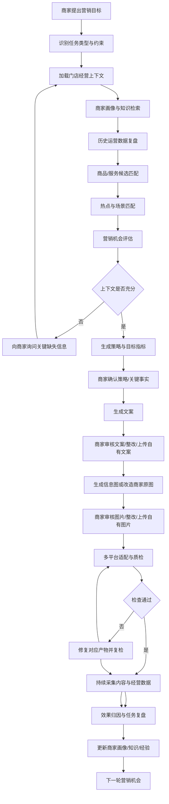

# AI 门店运营官 — 产品设计与 Demo 开发基线

> 文档版本：1.2  
> 日期：2026-11-10  
> 状态：产品设计基线（经营上下文、分项审核与素材共创流程已补充）  
> 目标仓库：`dujiu1024-dotcom/Smart-Marketing`

## 1. 产品定位

**AI 门店运营官：让 AI 真正替门店完成营销，并持续验证营销是否带来经营效果。**

产品不是 ERP、内容管理系统或营销任务看板。商家只需提出经营目标并对关键事项作出确认，AI 负责理解需求、制定策略、生产内容、适配渠道、检查质量、组织发布，并基于经营数据复盘迭代。

### 1.1 产品决策

| 维度 | 决策 |
|---|---|
| 产品定位 | AI 门店运营官 |
| 主要使用方式 | 按需制作 |
| AI 执行程度 | 完整营销执行官 |
| 核心竞争壁垒 | 可验证的经营效果 |
| 核心用户体验 | 目标驱动、对话式、交付物优先 |
| 人机边界 | AI 执行，商家确认关键事实、优惠和发布 |

### 1.2 设计原则

1. 一个需求有一个清晰入口。
2. AI 优先做默认决策，只在信息不足或涉及经营风险时提问。
3. 先展示营销成果，再展示执行细节。
4. 文案和图片可通过自然语言连续修改。
5. 发布、价格、优惠、商品事实等关键事项必须由商家确认。
6. 不把内部计划、依赖、子任务和版本管理复杂度暴露给商家。
7. 没有真实数据时明确标注模拟数据、缺失数据和归因可信度，不得伪造成功。

## 2. 用户与产品边界

### 2.1 门店商家

主要任务：
- 发起营销需求。
- 提供或确认商品、价格、优惠和素材。
- 查看 AI 方案与营销成果。
- 修改文案和图片。
- 确认内容及发布动作。
- 查看营销效果和下一步建议。

### 2.2 平台运营管理员

主要任务：
- 管理门店与账号连接。
- 配置模型、提示词和能力服务。
- 监控任务执行、失败、重试和成本。
- 管理数据采集及平台适配能力。
- 追踪系统级运行质量。

### 2.3 明确不做

- 不把商家端设计成 ERP。
- 不要求商家手动编排复杂工作流。
- 不把“固定文案 + 按钮”包装成 AI 能力。
- 不用静态数字冒充真实经营效果。
- 不将外部平台尚未开放或尚未接入的能力标记为已成功。

## 3. 信息架构

### 3.1 门店端：三个核心入口

| 一级入口 | 主要职责 | 关键页面/工作空间 |
|---|---|---|
| AI 营销 | 从目标到营销成果 | 需求输入、需求澄清、策略方案、文案工作室、图片工作室、多平台适配、质检、发布确认 |
| 营销任务 | 管理正在执行和历史营销 | 任务列表、任务详情、执行记录、待确认事项、失败恢复 |
| 经营效果 | 评估营销是否带来生意 | 效果总览、单次任务复盘、渠道表现、经营指标、下一步建议 |

辅助设置：
- 门店资料
- 商品资料库
- 图片素材库
- 平台账号授权
- 基础偏好设置

### 3.2 管理端

- 运营总览
- 门店管理
- 平台账号连接管理
- AI 模型与服务配置
- 提示词与能力配置
- 执行任务监控
- 失败与异常管理
- 成本和用量管理
- 数据采集与归因监控

管理端与门店端采用独立导航和权限边界。

## 4. 核心用户旅程

典型营销任务：

1. 商家输入目标，例如“推广新品，增加周末到店”。
2. AI 读取门店资料、商品信息、可用素材和历史效果。
3. 信息不足时只询问必要问题；信息充分时直接形成方案。
4. AI 生成目标客群、核心卖点、主题、渠道组合、优惠建议和衡量指标。
5. AI 生成文案、海报、商品视觉素材或短视频脚本。
6. 按渠道分别生成适配版本。
7. 执行内容、事实、价格、平台规范和图片质量检查。
8. 商家审阅并确认商品事实、价格、优惠和最终内容。
9. 根据渠道能力保存草稿或进入发布流程；需要人工操作的平台明确说明。
10. 采集可用的平台数据及门店经营数据。
11. 生成效果复盘、归因可信度和下一轮优化建议。

### 4.1 任务类型必须灵活

不是所有任务都执行完整流程。例如：
- “帮我把这张商品图换成夏日场景”：直接进入图片工作室。
- “给新品写一篇小红书笔记”：进入文案生成和平台适配。
- “策划周末促销”：进入需求理解、策略、内容、质检和发布流程。

AI 根据任务类型选择所需能力，不强迫用户走完固定表单。

## 5. 核心功能规格

### 5.1 AI 营销与策略中心

能力要求：
- 自然语言识别营销目标和任务类型。
- 读取门店、商品、价格、活动和素材上下文。
- 识别缺失信息及冲突事实。
- 热点/选题发现（依赖外部数据源时标明来源和更新时间）。
- 客群和消费场景分析。
- 商品卖点提炼。
- 营销主题、活动机制和渠道组合建议。
- 目标指标和衡量方式设定。
- 方案解释、调整、重生成和版本留存。

策略输出至少包含：
- 目标与目标指标
- 目标人群
- 消费场景
- 核心卖点
- 传播主题
- 内容方向
- 渠道与渠道理由
- 活动/优惠建议
- 所需素材
- 风险与待确认事项
- 衡量方式

价格、折扣、库存、营业时间等事实必须来自门店资料或商家确认，AI 不得自行编造。

### 5.2 AI 文案工作室

必须支持：
- 独立商家审核：文案生成后进入待审核状态，商家可通过、提出修改要求或上传/粘贴自己的文案作为新版本；未经审核通过不得进入最终发布包。
- 完整文案生成和多版本生成。
- 标题单独生成、替换和对比。
- 自然语言改写、扩写、缩写、纠错。
- 风格调整（如真实分享、种草、促销、专业介绍）。
- 卖点提炼、话题和标签建议。
- 平台字数及结构适配。
- 文案局部选择与修改。
- 历史版本、版本比较、恢复和保存。
- 多平台内容独立编辑。
- 复制、导出及进入发布确认。

交互要求：
- 编辑器与预览并列或可快速切换。
- AI 修改指令始终有明确作用对象。
- 修改后显示新旧版本差异。
- 自动保存草稿并显示保存状态。
- 生成失败可重试，不覆盖已有版本。

### 5.3 AI 图片工作室

图片生产明确区分两种模式：直接生成包含商品卖点/活动信息的营销信息图；基于商家上传的产品图、门店图等真实素材进行二次改造。两种模式的结果都必须由商家独立审核，商家可提出修改要求或上传自有图片替换。原图不得覆盖，改造结果需保留源图关联。

必须支持：
- 本地图片上传和商品图库选择。
- 商品原图、生成图和最终图管理。
- 文生图及图生图能力适配。
- 自然语言修改指令。
- 背景/场景替换、构图和色调优化。
- 局部编辑（需图像服务支持时启用）。
- 海报生成和文字排版。
- 方形、竖版、横版等画幅适配。
- 多版本生成、对比、收藏、恢复。
- 原图保护及非破坏式编辑历史。

推荐工作区布局：
- 左侧：商品素材、上传入口、素材分类。
- 中间：画布、图片预览和对比。
- 右侧：AI 指令、风格、画幅、生成选项。
- 底部：版本历史、生成结果和操作记录。

真实图像模型未配置时，必须显示“演示适配器/未连接”，不得将占位图描述为真实生成结果。

### 5.4 多平台适配中心

首期设计覆盖：
- 小红书：标题、正文、话题、图文结构。
- 抖音：短视频脚本、封面、标题、发布文案。
- 快手：本地化表达、短视频脚本和封面。
- 微信视频号：视频脚本、封面、标题和社交传播表达。

每个平台具有独立的：
- 内容版本
- 图片/视频素材规格
- 预览
- 质检结果
- 草稿/发布状态
- 操作记录

平台规则应配置化并标注更新时间。平台接口能力以实际授权和开放接口为准。

### 5.5 质量检查中心

检查维度：
- 商品名称、规格、卖点等事实准确性。
- 价格、折扣、活动时间和使用条件一致性。
- 风险用语、绝对化表达和平台规则。
- 文案完整性、可读性和行动引导。
- 图片清晰度、画幅、主体完整性。
- 图片内文字、价格和活动信息准确性。
- 品牌视觉一致性。

每条问题必须包含：
- 严重级别
- 问题位置
- 问题说明
- 证据或触发规则
- 修复建议
- 一键修复或人工处理入口
- 复检结果

检查结果不能全部固定为通过。规则检查与模型判断应区分，并记录检查版本。

### 5.6 发布中心

- 展示平台账号及授权状态。
- 展示各渠道最终内容和素材。
- 支持发布前预览和人工确认。
- 支持平台允许时保存草稿。
- 记录发布请求、返回结果、平台内容 ID 和时间。
- 明确区分“待确认、待发布、草稿已保存、发布处理中、已发布、失败、需人工操作”。
- 不支持自动发布的平台不得显示“发布成功”。
- 发布失败可查看原因并重试；重试需防止重复发布。

### 5.7 营销任务管理

每个任务独立保存：
- 任务目标和输入。
- 策略版本。
- 内容与素材版本。
- 渠道版本。
- 质检报告。
- 发布记录。
- 数据快照和复盘。
- 执行日志及人工操作记录。

支持搜索、筛选、状态查看、继续任务、复制任务、归档和失败恢复。

### 5.8 经营效果与复盘

数据分层：
1. 内容表现：曝光、阅读、播放、互动、收藏、分享。
2. 意向表现：私信、咨询、点击、领券。
3. 经营表现：到店、订单、销售额、客单价、核销。
4. 营销效率：转化率、获客成本、投入产出比。

每个指标需记录：
- 数值及统计周期
- 数据来源
- 更新时间
- 统计口径
- 是否真实采集/人工录入/模拟
- 与营销任务的关联方式
- 归因可信度

无数据时展示空状态、接入指引或数据缺失，不得填入貌似真实的固定数字。复盘应给出有效因素、无效因素、证据限制和下一轮可执行建议。

## 6. 任务状态机与执行机制

### 6.1 完整业务流程

策略型营销任务按经营上下文、策略确认、文案审核、图片审核、最终汇总确认、发布和效果复盘推进。文案与图片是两个独立交付物，必须分别审核、分别整改、分别留存版本。

~~~mermaid
flowchart TD
  A["商家提出营销目标"] --> B["AI理解需求与任务类型"]
  B --> C["构建门店经营上下文"]
  C --> D["历史运营复盘、商品匹配、热点匹配"]
  D --> E["营销机会评估与策略制定"]
  E --> F{"商家确认策略与关键事实"}
  F -->|"需调整"| E
  F -->|"确认"| G["AI生成营销文案"]
  G --> H["商家审核文案"]
  H --> I{"文案审核结果"}
  I -->|"提出修改要求"| J["AI按意见整改文案"]
  J --> H
  I -->|"上传自有文案"| K["导入商家文案并建立版本"]
  K --> H
  I -->|"审核通过"| L["进入图片制作"]
  L --> M{"选择图片生产方式"}
  M -->|"直接生成信息图"| N["AI根据策略/商品/文案生成信息图"]
  M -->|"商家图片二次改造"| O["商家上传产品图/门店图等原图"]
  O --> P["AI基于原图进行二次改造"]
  N --> Q["商家审核图片"]
  P --> Q
  Q --> R{"图片审核结果"}
  R -->|"提出修改要求"| S["AI按意见整改图片"]
  S --> Q
  R -->|"上传自有图片"| T["导入商家图片并建立版本"]
  T --> Q
  R -->|"审核通过"| U["文案与图片汇总"]
  U --> V["多平台适配与质量检查"]
  V --> W{"检查通过"}
  W -->|"否"| X["定位问题并修复对应产物"]
  X --> V
  W -->|"是"| Y["商家最终确认渠道内容"]
  Y --> Z["保存草稿/准备发布"]
  Z --> AA["平台授权发布或人工发布"]
  AA --> AB["采集内容表现与经营数据"]
  AB --> AC["效果分析与归因"]
  AC --> AD["更新画像、知识与营销经验"]
  AD --> AE["识别下一轮营销机会"]
  AE --> C
~~~

### 6.2 审核与整改规则

文案审核与图片审核必须是两个独立状态机，分别使用状态：draft、generating、waiting_for_review、revision_requested、revising、approved、replaced_by_merchant、rejected。

每个审核对象必须具备：
- 独立内容 ID 和版本号。
- 当前预览及生成方式/原始素材引用。
- 商家审核状态、审核人和审核时间。
- 商家意见/修改指令及对应版本。
- AI 整改输入、输出和轮次。
- 商家上传替代内容的来源、文件和上传时间。
- 审核通过记录及后续使用位置。

交互规则：
1. AI 生成文案后先展示文案审核界面，不自动进入最终确认或发布。
2. 商家可以逐段/整篇提出修改要求；AI 按指定范围整改，除非商家要求整体重写。
3. 商家可以上传或粘贴自己的文案，作为新版本保留，不覆盖 AI 原稿。
4. 文案审核通过后才进入依赖该文案的图片制作；图片引用已审核通过的文案版本。
5. 图片逐张或按组独立审核。商家可提出修改意见，或上传自有图片替换/补充。
6. 图片整改不得无故使文案审核失效；文案发生影响图片文字/卖点的重大变更时，只将相关图片标记为 stale 并重新检查。
7. “提出修改要求”不等于审核通过；未通过审核的产物不能进入最终发布包。
8. 商家自有内容与 AI 生成内容统一纳入版本、审核和素材追溯，并保留来源类型。

### 6.3 两种图片生产模式与真实性保护

**模式 A：直接生成信息图**
- 根据营销策略、商品资料和已审核文案，直接生成海报、促销图、商品卖点图、活动信息图等。
- 支持画幅、版式、品牌视觉、信息层级和文字布局调整。
- 图片内商品名称、价格、优惠、时间、地址等信息必须来自已确认资料；生成后检查文字可读性与事实准确性。

**模式 B：商家图片二次改造**
- 商家上传或从素材库选择产品图、门店图、环境图、服务过程图等真实素材。
- AI 基于原图进行背景/场景替换、构图调整、光影色调优化、视觉风格调整、增加设计元素和营销排版。
- 默认保留真实商品/门店主体及关键特征；不得擅自改变商品外观、规格、数量、门店真实环境或服务事实。可能影响真实性的改动需明确提示并由商家确认。
- 原图必须保留，所有改造结果作为新版本，不覆盖原始素材。

商家还可以直接上传已完成的文案、图片或设计稿作为本次任务交付物，选择直接采用、替换 AI 结果，或要求 AI 进一步修改。上传内容同样进入对应审核环节。

### 6.4 执行机制

- 支持任务暂停、取消、归档、单节点失败、局部重试和断点恢复。
- 文案和图片分别整改、分别审核、分别通过。
- 幂等执行，避免重复生成、重复扣费或重复发布。
- 每次执行记录输入、输出、耗时、成本和错误码。
- 任务类型可跳过不相关节点，但必须记录跳过原因。

## 7. 领域数据模型

| 实体 | 关键职责 |
|---|---|
| Store | 门店基础资料、经营属性和配置 |
| Product | 商品名称、规格、价格、卖点、图片 |
| Offer | 优惠、活动规则、有效期和适用条件 |
| ChannelAccount | 渠道账号、授权状态和权限 |
| CampaignTask | 一次营销任务及生命周期 |
| StrategyVersion | 营销策略的版本化快照 |
| ContentAsset | 文案、图片、视频等资产元数据，含来源类型、生成模式和原始素材关联 |
| ContentReview | 文案/图片独立审核状态、意见、版本、整改轮次和审核记录 |
| ImageProductionJob | 信息图生成或商家原图二次改造任务及其输入输出 |
| ChannelVariant | 每个平台独立的内容版本 |
| QualityReport | 质检项、问题、修复及复检结果 |
| PublishRecord | 草稿和发布操作记录 |
| MetricSnapshot | 某一周期的渠道或经营指标快照 |
| AttributionRecord | 营销与咨询、到店、订单、核销的关联 |
| ExecutionEvent | 节点执行、状态变化、错误和人工操作 |
| ModelInvocation | 模型、参数、耗时、用量和成本记录 |

关键约束：
- 数据必须按门店隔离。
- 内容与策略采用版本化，不覆盖历史。
- 发布记录和执行事件只追加，不静默篡改。
- 敏感凭证不得明文存储或返回前端。
- 指标必须携带来源、时间和口径。

## 8. 技术架构建议

### 8.1 推荐结构

- 前端：React + TypeScript。
- 后端：FastAPI。
- 数据库：开发阶段 SQLite；部署阶段 PostgreSQL。
- 文件资产：对象存储，开发阶段可用本地存储适配器。
- 异步任务：任务队列 + Worker。
- AI：文本模型、图像模型独立适配层。
- 渠道：账号授权、草稿、发布、数据采集适配器。
- 观测：结构化日志、任务追踪、模型用量和成本统计。

### 8.2 服务边界

1. Identity/Store：用户、角色、门店和权限。
2. Catalog：商品、优惠和素材。
3. Campaign：任务、策略和状态机。
4. Content：文案、图片、平台版本和资产。
5. AI Gateway：模型路由、提示词、重试、用量与成本。
6. Quality：规则检查和模型辅助检查。
7. Channel Adapter：账号、草稿、发布及数据读取。
8. Analytics：指标、归因和复盘。
9. Admin/Observability：配置、监控和异常处理。

### 8.3 适配器原则

所有外部服务都通过接口适配：
- TextModelProvider
- ImageModelProvider
- StorageProvider
- ChannelProvider
- MetricsProvider

开发阶段可以提供 Mock/Local Adapter，但必须：
- 在界面和数据中标记模拟模式。
- 与真实适配器使用相同输入输出契约。
- 支持失败、超时、重试等状态测试。
- 不把模拟成功混入真实经营报表。
- 配置真实服务后无需重写核心业务流程。

## 9. Demo 的定义与边界

本项目下一版目标不是静态视觉稿，而是**可运行、可操作、可验证的产品级交互原型**。

### 9.1 必须真实可操作的产品行为

- 页面导航和跨页面状态一致。
- 创建多个独立任务。
- 任务输入、策略、内容和素材关联。
- 文案生成/编辑/改写/保存/版本恢复。
- 图片上传/选择/编辑指令/结果管理。
- 多平台内容独立编辑和预览。
- 规则质检、问题定位和修复。
- 发布确认、草稿状态和操作记录。
- 任务筛选、继续、失败重试和恢复。
- 数据来源、模拟标识和复盘逻辑。
- 管理端配置保存及状态反馈。
- 刷新页面后关键数据仍然存在。

### 9.2 真实服务与模拟服务的标识

| 能力 | 未配置真实服务时 | 接入后 |
|---|---|---|
| 文本生成 | 使用明确标注的演示适配器或提示配置状态 | 调用真实文本模型 |
| 图片生成/编辑 | 显示未连接或演示模式，不伪造生成成功 | 调用真实图像模型 |
| 平台发布 | 显示未授权/需人工操作 | 根据平台接口执行 |
| 平台数据 | 显示未接入或样例数据 | 读取真实数据 |
| 门店经营数据 | 显示人工录入/样例/未接入 | 对接 POS/订单等数据源 |

Demo 的交互可以完整，但外部服务的真实效果必须如实呈现。不能以“按钮能点”作为功能完成的唯一标准。

## 10. 页面级验收标准

| 模块 | 验收条件 |
|---|---|
| AI 营销入口 | 输入目标后能创建独立任务，识别任务类型 |
| 策略中心 | 生成结构化策略，可编辑、重生成、留版本 |
| 文案工作室 | 支持生成后独立商家审核、修改要求整改、上传自有文案、多版本保存和恢复 |
| 图片工作室 | 支持信息图直接生成、商家产品图/门店图二次改造、自有图片上传、独立审核整改和版本追溯 |
| 多平台适配 | 各渠道内容独立，规格、预览和状态可见 |
| 质检中心 | 规则实际运行，问题定位、修复、复检可用 |
| 发布中心 | 授权状态清晰，确认和草稿/发布状态准确 |
| 任务管理 | 多任务隔离，刷新后保留，支持恢复和重试 |
| 经营效果 | 指标有来源、时间、口径和真实性标记 |
| 商品/素材 | 可新增、编辑、搜索、选择并关联任务 |
| 管理端 | 配置可保存，状态和权限生效 |
| 异常处理 | 错误可见、可恢复，不虚报成功 |

### 10.1 全局验收

- 不存在无响应按钮。
- 不存在仅改变文字却没有业务含义的交互。
- 不存在所有任务共享同一份状态的问题。
- 不存在刷新后丢失关键任务数据的问题。
- 不存在模拟数据伪装真实数据的问题。
- 不存在发布未执行却显示成功的问题。
- 主要流程具备空状态、加载态、成功态、失败态。
- 桌面端和常见移动宽度下可用。
- 页面、操作和数据权限符合门店/管理员角色。

## 11. 开发计划

### 阶段 0：基线与工程准备
- 确认产品需求和页面清单。
- 建立前后端工程、路由和权限。
- 定义领域模型、接口契约和持久化。
- 建立统一设计系统和组件规范。

### 阶段 1：核心产品骨架
- 门店端三个入口和辅助设置。
- 管理端独立工作区。
- 多任务数据模型和状态机。
- 本地持久化及跨页面状态。

### 阶段 2：营销内容生产
- AI 需求理解和策略版本。
- 文案工作室。
- 图片工作室。
- 商品和素材库。
- 多平台内容适配。

### 阶段 3：执行闭环
- 质量检查和修复。
- 发布确认和草稿状态。
- 任务执行记录、重试和恢复。
- 渠道适配器接口。

### 阶段 4：经营效果
- 指标模型和数据来源。
- 经营效果看板。
- 单次任务复盘。
- 归因可信度和策略迭代。

### 阶段 5：验收与服务接入
- 全页面交互验收。
- 状态、异常和持久化测试。
- 接入真实文本/图像模型。
- 按平台政策和授权接入渠道。
- 接入门店订单、到店和核销数据。

## 12. 开发纪律与交付要求

1. 先按本文档建立页面、数据和交互清单，再开发。
2. 每个功能先定义用户动作、输入、输出、状态和异常。
3. 不允许用静态截图或不可交互卡片代替核心功能。
4. 每完成一个模块，按对应验收条件自测。
5. 变更产品范围时更新本文档和验收清单。
6. 演示适配器必须有显著标识，不能冒充真实 AI 或平台能力。
7. 交付时提供运行方式、配置说明、已实现能力、未接入能力和已知限制。
8. 以端到端用户任务是否完成为验收单位，而不是以页面是否存在为验收单位。

## 13. 首期范围建议

首期优先打通一个完整的营销闭环：
- 一个门店。
- 商品资料和素材库。
- 营销目标输入。
- 策略生成与确认。
- 文案生成、编辑和版本管理。
- 商品图片选择、图像生成/编辑适配。
- 至少两个渠道的内容适配。
- 质检、商家确认和发布准备。
- 任务留存与基础效果复盘。

平台扩展、自动发布、完整归因和多门店集团管理按接口可用性分阶段推进。

---

**产品验收总原则：商家提出目标后，系统必须能够围绕目标完成相应营销工作；每一步有真实业务状态、可检查的产物和明确的失败处理；凡是依赖外部服务的能力，必须如实标注接入状态。**

# 14. 经营上下文与营销决策引擎（关键补充）

> 本章补充并细化第 4、5、6、7、8、9、10、11 章。凡与前文简化流程冲突之处，以本章定义为准。

## 14.1 核心原则：先理解商家，再决定营销

营销任务不能在理解用户输入后直接进入内容生成。每次任务都必须先构建一份可追溯的“门店经营上下文（Store Context）”，并基于上下文完成分析、匹配和机会判断。

上下文至少包含六类信息：

1. **商家画像**：门店类型、定位、区域、服务半径、客群、价格带、经营时段、品牌调性、经营目标、竞争优势和约束。
2. **商品与服务画像**：商品/服务目录、价格、毛利区间（如可提供）、库存/产能、季节性、适用人群、消费场景、卖点、差异化、可用图片视频和限制条件。
3. **历史运营数据**：历史营销任务、渠道内容表现、互动、咨询、线索、到店、订单、销售额、核销、投入和成本，以及数据质量和归因可信度。
4. **热点与外部环境**：本地热点、节日节气、天气、季节、平台趋势、区域活动、行业话题、竞品公开动态（来源可用时）。
5. **商家知识库**：品牌故事、门店介绍、服务流程、常见问答、产品知识、用户评价、禁忌表达、品牌语气、活动规则、售后政策和经营 SOP。
6. **本次任务约束**：商家目标、预算、时间、渠道、活动限制、目标商品、必须包含/禁止出现的内容及商家明确指令。

这些信息应按门店隔离、来源分级、时间标记和版本化管理。AI 不得将推测当成事实。

## 14.2 商家画像（Merchant Profile）

商家画像不是一次性注册表，而是持续更新的门店认知档案。

建议字段：

| 画像维度 | 典型字段 |
|---|---|
| 基础身份 | 行业、门店类型、门店名称、位置、门店数量、营业时间 |
| 市场定位 | 品牌定位、价格带、核心优势、差异化、竞争环境 |
| 客群画像 | 主要客群、年龄/消费层级等已合法获得的群体特征、消费动机、到店半径 |
| 经营模型 | 核心品类、主推商品、利润结构（可选）、服务能力、产能/库存约束 |
| 品牌表达 | 品牌语气、视觉风格、常用表达、禁用表达 |
| 营销偏好 | 常用渠道、内容偏好、促销接受度、预算边界 |
| 经营目标 | 拉新、复购、客单价、清库存、新品推广、淡季引流等 |
| 约束与风险 | 资质、广告限制、服务区域、供应限制、活动规则 |

画像字段需记录值、来源、更新时间、置信度和确认状态。关键经营事实（价格、资质、库存、营业时间、服务承诺）应优先使用商家确认的数据。

画像建立机制：
- 首次入驻：通过简短访谈、资料导入和已有商品信息建立基础画像。
- 日常任务：从商家指令和任务反馈中提取可复用偏好，先作为“待确认认知”。
- 定期复核：对过期、冲突或低置信度信息提示确认。
- 商家控制：允许查看、修改、确认和删除不准确的画像信息。

## 14.3 商家知识库（Merchant Knowledge）

知识库是营销生成的事实依据，不等同于普通文件上传区。

知识分类：
- 品牌知识：品牌故事、定位、价值主张、品牌语气。
- 门店知识：地址、交通、营业时间、环境、服务范围、预约方式。
- 商品知识：商品规格、原料/成分、功能特点、适用场景、价格和限制。
- 服务知识：服务流程、预约规则、售后政策、注意事项。
- 活动知识：优惠门槛、有效期、适用商品、叠加规则、核销方式。
- 用户声音：评价、常见问题、真实反馈和高频痛点。
- 内容规范：禁用词、合规要求、品牌视觉和表达规范。

知识入库需要支持文档/表格/图片等来源解析、人工录入、标签分类、去重、有效期、来源引用和版本管理。检索结果应返回知识片段及其来源，便于策略和质检追溯。

冲突处理优先级建议：
1. 商家本次明确确认的有效指令/事实。
2. 商家维护且仍有效的结构化资料。
3. 经商家确认的知识库内容。
4. 可追溯的历史交易/运营数据。
5. 外部可信来源。
6. AI 推断（只能作为建议，不得当成事实）。

若价格、活动条件、库存、资质等关键事实存在冲突，必须暂停相关内容生产或将其标记为待确认。

## 14.4 历史运营数据复盘：必须前置进入决策

历史数据复盘不应只放在营销发布之后。每次策略制定之前，都应检索并分析与本次任务相关的历史表现。

分析维度：
- 时间维度：近期、同比/环比、节假日和季节周期。
- 商品维度：商品/品类带来的曝光、咨询、到店、订单和销售。
- 内容维度：主题、标题、卖点、内容形式、素材风格和 CTA。
- 渠道维度：各平台的触达、互动、咨询和转化差异。
- 人群/场景维度：不同客群、时段、区域和消费场景的表现（数据可用时）。
- 成本维度：投放费用、制作成本、优惠成本和获客成本（数据可用时）。

每次复盘至少输出：
- 哪些商品/主题/渠道/内容表现较好。
- 哪些做法表现较差或未达到目标。
- 可能影响结果的因素及证据。
- 数据缺失、样本量和归因限制。
- 本次策略应继承、调整或避免的经验。
- 建议验证的新假设。

不得仅凭曝光或点赞判定经营成功。优先看与任务目标一致的指标，例如到店、订单、核销和有效咨询。历史数据不足时应明确说明，不能生成虚构结论。

## 14.5 商品匹配引擎（Product Matching）

每次营销任务都要先判断“这次应该推广什么”，不能默认商家输入的商品就是最优商品，也不能每次只推广同一个主推商品。

匹配输入：
- 商家本次目标。
- 商家画像和经营约束。
- 商品/服务目录。
- 商品价格、毛利、库存/产能和有效期（若有）。
- 历史商品表现。
- 当前季节、节日、天气和消费场景。
- 可用素材质量与完整度。
- 商家指定的必选/排除商品。

匹配因素：
- 与营销目标的相关性。
- 与目标客群和消费场景的匹配度。
- 当前需求/季节/热点关联度。
- 历史经营效果及其可信度。
- 利润、库存和履约能力（数据可用时）。
- 商品差异化和可传播性。
- 素材可用性。
- 风险、资质和活动约束。

输出应包含：
- 推荐商品及排序。
- 每个商品的匹配理由和证据。
- 适合的营销目标与人群。
- 可用卖点和素材。
- 风险/缺失信息。
- 不推荐商品及原因（必要时）。
- 是否需要商家确认。

可使用可配置的多因素评分作为排序辅助，但不能将评分伪装成客观经营结果。硬约束（停售、库存不足、活动过期、资质不符、商家排除）优先于分数。涉及价格、库存、利润和优惠承诺时必须确认数据有效性。

## 14.6 热点匹配引擎（Trend Matching）

热点发现不等于把热门话题塞进内容。系统需要判断热点是否适合该门店、商品、客群和营销目标。

热点类型：
- 节日节气和固定消费节点。
- 本地城市/商圈事件和活动。
- 天气、季节和即时生活场景。
- 平台热门话题、内容趋势和挑战。
- 行业趋势及品类话题。
- 可合法获取的竞品公开动态。

匹配维度：
- 地域相关性。
- 时间窗口和热度变化。
- 与商家行业及商品的相关性。
- 与目标客群的相关性。
- 与本次营销目标的相关性。
- 品牌调性适配度。
- 参与成本、内容制作难度和转化可能性。
- 舆情、版权、平台规范和品牌安全风险。

热点候选必须记录来源、抓取/观察时间、有效窗口、地域范围和可信度。过期热点自动降权或失效。热点建议需说明“为什么适合这家店”，并提供可执行的切入角度；不适合的热点应明确过滤，不为了追热点而追热点。

## 14.7 营销机会判断（Opportunity Assessment）

完成商家画像、历史复盘、商品匹配和热点匹配后，AI 先形成营销机会判断，再决定是否制定方案。

机会判断至少回答：
1. 当前门店最值得解决的经营问题是什么？
2. 这次营销最适合推广哪个商品/服务？
3. 目标客群和消费场景是什么？
4. 是否有适合参与的热点/时间节点？若无，是否应采用常规主题？
5. 历史数据给出了什么可用经验？
6. 哪些事实、素材或数据仍然缺失？
7. 建议的营销目标、策略方向和衡量指标是什么？
8. 有哪些风险、成本和执行约束？

系统应允许得出“当前不建议追热点”“暂不建议促销”“先补充商品素材/库存信息”等结论，而不是每次强行生成一套活动。

## 14.8 更新后的完整任务决策流

下面是策略型营销任务的标准流程。轻量任务可按需跳过不相关节点，但仍需读取相关上下文。

### 14.8.1 状态机不是单纯线性步骤

每个阶段应定义为独立状态节点，具备：
- 状态：pending、running、waiting_for_user、succeeded、failed、skipped、stale。
- 输入上下文版本。
- 输出产物引用。
- 开始/结束时间。
- 证据与来源。
- 失败原因和重试策略。
- 是否需要商家确认。
- 上下游依赖关系。

推荐主阶段：
1. request_understanding
2. context_assembly
3. merchant_profile_review
4. historical_performance_analysis
5. product_matching
6. trend_matching
7. opportunity_assessment
8. strategy_planning
9. merchant_strategy_approval
10. copy_generation
11. merchant_copy_review
12. copy_revision_or_merchant_upload
13. image_production
14. merchant_image_review
15. image_revision_or_merchant_upload
16. channel_adaptation
17. quality_assurance
18. merchant_final_approval
19. publishing
20. performance_collection
21. campaign_review
22. knowledge_and_profile_update

允许任务类型选择性跳过节点，但必须记录 skip_reason、适用条件和被跳过的依赖。比如纯图片编辑可以跳过历史营销复盘和热点匹配，但仍需加载商品事实、品牌视觉知识和图片素材上下文。

### 14.8.2 上下文版本与动态刷新

- 创建任务时生成 ContextSnapshot，记录画像、知识、商品、历史指标和热点数据的版本/时间。
- 策略和内容产物必须记录引用了哪个 ContextSnapshot。
- 关键数据变化（价格、库存、活动有效期、门店营业状态、热点过期）时，将相关节点标记为 stale。
- 上下文更新后，只重跑受影响的下游节点，不必重做整个任务。
- 商家手动修改画像或知识时，记录变更来源和生效时间。
- 任务执行期间商家明确给出的新指令优先级最高，但与安全/合规规则冲突时必须阻断并解释。

## 14.9 新增领域对象

在第 7 章实体基础上新增：

| 实体 | 关键职责 |
|---|---|
| MerchantProfile | 商家/门店画像及字段级来源、置信度、确认状态 |
| KnowledgeDocument | 商家知识文档、版本、权限和有效期 |
| KnowledgeChunk | 可检索知识片段及原文来源定位 |
| ContextSnapshot | 单次任务使用的经营上下文快照 |
| ContextEvidence | 画像、知识、数据和外部来源的证据引用 |
| HistoricalInsight | 历史运营分析结论、样本量和可信度 |
| ProductMatch | 商品候选、匹配因素、排序理由和排除原因 |
| TrendItem | 热点信息、来源、地域、时间窗口和风险 |
| TrendMatch | 热点与门店/商品/任务的匹配理由和评分 |
| OpportunityAssessment | 营销机会、建议方向、约束和待确认事项 |
| MetricDefinition | 指标口径、来源和计算规则 |

## 14.10 上下文服务与技术模块补充

在第 8 章服务边界基础上增加：
1. **Merchant Profile Service**：画像建立、确认、更新和冲突检测。
2. **Knowledge Service**：知识导入、解析、切片、检索、引用和有效期管理。
3. **Context Orchestrator**：按任务类型聚合上下文，构建 ContextSnapshot。
4. **Historical Intelligence**：历史指标分析、分群对比、洞察和证据置信度。
5. **Product Matching Engine**：商品候选召回、硬约束过滤和多因素排序。
6. **Trend Intelligence**：热点采集、去重、时效判断、地域与品类匹配。
7. **Opportunity Engine**：综合画像、商品、热点、历史经验和任务约束，形成营销机会判断。

推荐执行顺序：
- 先通过结构化过滤得到可用商品/热点候选。
- 再用规则和模型进行相关性判断及排序。
- 最后生成带证据的机会判断和策略建议。
- 对关键事实执行规则校验，不让模型自由编造。

## 14.11 Demo 页面与交互补充

商家端不应暴露复杂的内部引擎流程，但要让用户知道 AI 根据什么做出建议。

AI 营销任务中增加一个轻量的“本次营销依据”区域，默认摘要展示：
- 已理解的门店特点。
- 本次参考的历史经营发现。
- 推荐商品及推荐原因。
- 匹配到的热点/场景（无合适热点时明确显示）。
- 使用的商家知识和素材。
- 仍需商家确认的信息。

用户可以展开查看来源和细节，也可以纠正 AI 对门店、商品或客群的理解。

商家画像与知识库设置页面：
- 画像概览、字段编辑、待确认信息。
- 知识分类、搜索、导入、来源和有效期。
- 过期知识、冲突知识和缺失知识提醒。

任务详情增加：
- 本次上下文快照。
- 历史数据复盘结论。
- 商品匹配结果。
- 热点匹配结果。
- 营销机会评估。
- 策略与上下文之间的证据关系。

管理端增加：
- 热点数据源状态和更新时间。
- 知识索引状态。
- 历史数据质量与同步状态。
- 上下文构建耗时和缺失率。
- 商品/热点匹配结果抽检。
- 模型洞察的证据引用和置信度监控。

## 14.12 新增验收标准

| 能力 | 验收条件 |
|---|---|
| 商家画像 | 能建立、编辑、确认画像；字段有来源、时间和置信度 |
| 知识库 | 能导入/维护知识，检索结果可追溯到原始来源 |
| 上下文快照 | 每个营销任务保存独立快照，产物可追溯所用上下文 |
| 历史复盘 | 策略生成前执行相关历史分析；无数据时明确标记 |
| 商品匹配 | 能从商品池筛选、排序、解释和排除商品 |
| 热点匹配 | 能筛选热点并评估地域、时效、品牌和商品相关性 |
| 机会判断 | 能综合上述证据形成建议，也能判断不追热点/不促销 |
| 动态更新 | 关键上下文变化后标记过期节点，并仅重跑受影响部分 |
| 商家纠正 | 商家可纠正画像、知识和推荐，系统记录反馈 |
| 证据追溯 | 策略中的关键判断能查看依据、来源和数据时间 |
| 任务类型适配 | 轻量任务能跳过无关步骤且记录原因 |

## 14.13 开发优先级调整

上下文能力不是后期锦上添花，应提前成为策略生成的基础依赖。建议调整阶段顺序：

### 新阶段 1：门店认知与上下文底座
- 门店/商家画像。
- 商品与服务结构化资料。
- 商家知识库和来源引用。
- 历史运营数据导入及指标口径。
- ContextSnapshot 和上下文编排。

### 新阶段 2：营销智能决策
- 历史运营复盘。
- 商品匹配。
- 热点采集与匹配。
- 营销机会评估。
- 策略生成及证据追溯。

### 新阶段 3：营销内容生产
- 文案工作室。
- 图片工作室。
- 多平台适配。
- 质量检查和商家确认。

### 新阶段 4：发布与经营闭环
- 发布/草稿适配。
- 数据采集、归因和复盘。
- 画像、知识和历史经验更新。
- 下一轮策略迭代。

**新增总原则：没有完成与本次任务相关的经营上下文检索、历史复盘、商品匹配和热点适配，就不能把策略生成标记为完成；若某项数据源不可用，必须明确记录缺失原因，并降低结论置信度。**
