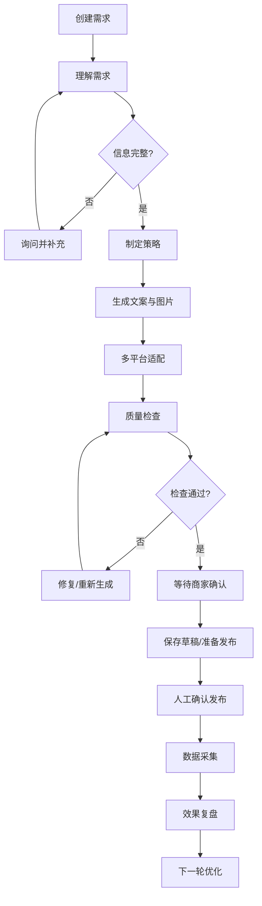

# AI 门店运营官 — 产品设计与 Demo 开发基线

> 文档版本：1.0  
> 日期：2026-11-10  
> 状态：产品设计基线（待评审）  
> 目标仓库：`dujiu1024-dotcom/Smart-Marketing`

## 1. 产品定位

**AI 门店运营官：让 AI 真正替门店完成营销，并持续验证营销是否带来经营效果。**

产品不是 ERP、内容管理系统或营销任务看板。商家只需提出经营目标并对关键事项作出确认，AI 负责理解需求、制定策略、生产内容、适配渠道、检查质量、组织发布，并基于经营数据复盘迭代。

### 1.1 产品决策

| 维度 | 决策 |
|---|---|
| 产品定位 | AI 门店运营官 |
| 主要使用方式 | 按需制作 |
| AI 执行程度 | 完整营销执行官 |
| 核心竞争壁垒 | 可验证的经营效果 |
| 核心用户体验 | 目标驱动、对话式、交付物优先 |
| 人机边界 | AI 执行，商家确认关键事实、优惠和发布 |

### 1.2 设计原则

1. 一个需求有一个清晰入口。
2. AI 优先做默认决策，只在信息不足或涉及经营风险时提问。
3. 先展示营销成果，再展示执行细节。
4. 文案和图片可通过自然语言连续修改。
5. 发布、价格、优惠、商品事实等关键事项必须由商家确认。
6. 不把内部计划、依赖、子任务和版本管理复杂度暴露给商家。
7. 没有真实数据时明确标注模拟数据、缺失数据和归因可信度，不得伪造成功。

## 2. 用户与产品边界

### 2.1 门店商家

主要任务：
- 发起营销需求。
- 提供或确认商品、价格、优惠和素材。
- 查看 AI 方案与营销成果。
- 修改文案和图片。
- 确认内容及发布动作。
- 查看营销效果和下一步建议。

### 2.2 平台运营管理员

主要任务：
- 管理门店与账号连接。
- 配置模型、提示词和能力服务。
- 监控任务执行、失败、重试和成本。
- 管理数据采集及平台适配能力。
- 追踪系统级运行质量。

### 2.3 明确不做

- 不把商家端设计成 ERP。
- 不要求商家手动编排复杂工作流。
- 不把“固定文案 + 按钮”包装成 AI 能力。
- 不用静态数字冒充真实经营效果。
- 不将外部平台尚未开放或尚未接入的能力标记为已成功。

## 3. 信息架构

### 3.1 门店端：三个核心入口

| 一级入口 | 主要职责 | 关键页面/工作空间 |
|---|---|---|
| AI 营销 | 从目标到营销成果 | 需求输入、需求澄清、策略方案、文案工作室、图片工作室、多平台适配、质检、发布确认 |
| 营销任务 | 管理正在执行和历史营销 | 任务列表、任务详情、执行记录、待确认事项、失败恢复 |
| 经营效果 | 评估营销是否带来生意 | 效果总览、单次任务复盘、渠道表现、经营指标、下一步建议 |

辅助设置：
- 门店资料
- 商品资料库
- 图片素材库
- 平台账号授权
- 基础偏好设置

### 3.2 管理端

- 运营总览
- 门店管理
- 平台账号连接管理
- AI 模型与服务配置
- 提示词与能力配置
- 执行任务监控
- 失败与异常管理
- 成本和用量管理
- 数据采集与归因监控

管理端与门店端采用独立导航和权限边界。

## 4. 核心用户旅程

典型营销任务：

1. 商家输入目标，例如“推广新品，增加周末到店”。
2. AI 读取门店资料、商品信息、可用素材和历史效果。
3. 信息不足时只询问必要问题；信息充分时直接形成方案。
4. AI 生成目标客群、核心卖点、主题、渠道组合、优惠建议和衡量指标。
5. AI 生成文案、海报、商品视觉素材或短视频脚本。
6. 按渠道分别生成适配版本。
7. 执行内容、事实、价格、平台规范和图片质量检查。
8. 商家审阅并确认商品事实、价格、优惠和最终内容。
9. 根据渠道能力保存草稿或进入发布流程；需要人工操作的平台明确说明。
10. 采集可用的平台数据及门店经营数据。
11. 生成效果复盘、归因可信度和下一轮优化建议。

### 4.1 任务类型必须灵活

不是所有任务都执行完整流程。例如：
- “帮我把这张商品图换成夏日场景”：直接进入图片工作室。
- “给新品写一篇小红书笔记”：进入文案生成和平台适配。
- “策划周末促销”：进入需求理解、策略、内容、质检和发布流程。

AI 根据任务类型选择所需能力，不强迫用户走完固定表单。

## 5. 核心功能规格

### 5.1 AI 营销与策略中心

能力要求：
- 自然语言识别营销目标和任务类型。
- 读取门店、商品、价格、活动和素材上下文。
- 识别缺失信息及冲突事实。
- 热点/选题发现（依赖外部数据源时标明来源和更新时间）。
- 客群和消费场景分析。
- 商品卖点提炼。
- 营销主题、活动机制和渠道组合建议。
- 目标指标和衡量方式设定。
- 方案解释、调整、重生成和版本留存。

策略输出至少包含：
- 目标与目标指标
- 目标人群
- 消费场景
- 核心卖点
- 传播主题
- 内容方向
- 渠道与渠道理由
- 活动/优惠建议
- 所需素材
- 风险与待确认事项
- 衡量方式

价格、折扣、库存、营业时间等事实必须来自门店资料或商家确认，AI 不得自行编造。

### 5.2 AI 文案工作室

必须支持：
- 完整文案生成和多版本生成。
- 标题单独生成、替换和对比。
- 自然语言改写、扩写、缩写、纠错。
- 风格调整（如真实分享、种草、促销、专业介绍）。
- 卖点提炼、话题和标签建议。
- 平台字数及结构适配。
- 文案局部选择与修改。
- 历史版本、版本比较、恢复和保存。
- 多平台内容独立编辑。
- 复制、导出及进入发布确认。

交互要求：
- 编辑器与预览并列或可快速切换。
- AI 修改指令始终有明确作用对象。
- 修改后显示新旧版本差异。
- 自动保存草稿并显示保存状态。
- 生成失败可重试，不覆盖已有版本。

### 5.3 AI 图片工作室

必须支持：
- 本地图片上传和商品图库选择。
- 商品原图、生成图和最终图管理。
- 文生图及图生图能力适配。
- 自然语言修改指令。
- 背景/场景替换、构图和色调优化。
- 局部编辑（需图像服务支持时启用）。
- 海报生成和文字排版。
- 方形、竖版、横版等画幅适配。
- 多版本生成、对比、收藏、恢复。
- 原图保护及非破坏式编辑历史。

推荐工作区布局：
- 左侧：商品素材、上传入口、素材分类。
- 中间：画布、图片预览和对比。
- 右侧：AI 指令、风格、画幅、生成选项。
- 底部：版本历史、生成结果和操作记录。

真实图像模型未配置时，必须显示“演示适配器/未连接”，不得将占位图描述为真实生成结果。

### 5.4 多平台适配中心

首期设计覆盖：
- 小红书：标题、正文、话题、图文结构。
- 抖音：短视频脚本、封面、标题、发布文案。
- 快手：本地化表达、短视频脚本和封面。
- 微信视频号：视频脚本、封面、标题和社交传播表达。

每个平台具有独立的：
- 内容版本
- 图片/视频素材规格
- 预览
- 质检结果
- 草稿/发布状态
- 操作记录

平台规则应配置化并标注更新时间。平台接口能力以实际授权和开放接口为准。

### 5.5 质量检查中心

检查维度：
- 商品名称、规格、卖点等事实准确性。
- 价格、折扣、活动时间和使用条件一致性。
- 风险用语、绝对化表达和平台规则。
- 文案完整性、可读性和行动引导。
- 图片清晰度、画幅、主体完整性。
- 图片内文字、价格和活动信息准确性。
- 品牌视觉一致性。

每条问题必须包含：
- 严重级别
- 问题位置
- 问题说明
- 证据或触发规则
- 修复建议
- 一键修复或人工处理入口
- 复检结果

检查结果不能全部固定为通过。规则检查与模型判断应区分，并记录检查版本。

### 5.6 发布中心

- 展示平台账号及授权状态。
- 展示各渠道最终内容和素材。
- 支持发布前预览和人工确认。
- 支持平台允许时保存草稿。
- 记录发布请求、返回结果、平台内容 ID 和时间。
- 明确区分“待确认、待发布、草稿已保存、发布处理中、已发布、失败、需人工操作”。
- 不支持自动发布的平台不得显示“发布成功”。
- 发布失败可查看原因并重试；重试需防止重复发布。

### 5.7 营销任务管理

每个任务独立保存：
- 任务目标和输入。
- 策略版本。
- 内容与素材版本。
- 渠道版本。
- 质检报告。
- 发布记录。
- 数据快照和复盘。
- 执行日志及人工操作记录。

支持搜索、筛选、状态查看、继续任务、复制任务、归档和失败恢复。

### 5.8 经营效果与复盘

数据分层：
1. 内容表现：曝光、阅读、播放、互动、收藏、分享。
2. 意向表现：私信、咨询、点击、领券。
3. 经营表现：到店、订单、销售额、客单价、核销。
4. 营销效率：转化率、获客成本、投入产出比。

每个指标需记录：
- 数值及统计周期
- 数据来源
- 更新时间
- 统计口径
- 是否真实采集/人工录入/模拟
- 与营销任务的关联方式
- 归因可信度

无数据时展示空状态、接入指引或数据缺失，不得填入貌似真实的固定数字。复盘应给出有效因素、无效因素、证据限制和下一轮可执行建议。

## 6. 任务状态机与执行机制

### 6.1 典型状态流

实际实现还需支持：
- 任务暂停、取消和归档。
- 单节点失败与局部重试。
- 断点恢复。
- 幂等执行，避免重复生成、重复扣费或重复发布。
- 超时、限流和服务不可用处理。
- 每次执行的输入、输出、耗时、成本和错误码记录。

任务类型可跳过不相关节点，但必须记录跳过原因。

## 7. 领域数据模型

| 实体 | 关键职责 |
|---|---|
| Store | 门店基础资料、经营属性和配置 |
| Product | 商品名称、规格、价格、卖点、图片 |
| Offer | 优惠、活动规则、有效期和适用条件 |
| ChannelAccount | 渠道账号、授权状态和权限 |
| CampaignTask | 一次营销任务及生命周期 |
| StrategyVersion | 营销策略的版本化快照 |
| ContentAsset | 文案、图片、视频等资产元数据 |
| ChannelVariant | 每个平台独立的内容版本 |
| QualityReport | 质检项、问题、修复及复检结果 |
| PublishRecord | 草稿和发布操作记录 |
| MetricSnapshot | 某一周期的渠道或经营指标快照 |
| AttributionRecord | 营销与咨询、到店、订单、核销的关联 |
| ExecutionEvent | 节点执行、状态变化、错误和人工操作 |
| ModelInvocation | 模型、参数、耗时、用量和成本记录 |

关键约束：
- 数据必须按门店隔离。
- 内容与策略采用版本化，不覆盖历史。
- 发布记录和执行事件只追加，不静默篡改。
- 敏感凭证不得明文存储或返回前端。
- 指标必须携带来源、时间和口径。

## 8. 技术架构建议

### 8.1 推荐结构

- 前端：React + TypeScript。
- 后端：FastAPI。
- 数据库：开发阶段 SQLite；部署阶段 PostgreSQL。
- 文件资产：对象存储，开发阶段可用本地存储适配器。
- 异步任务：任务队列 + Worker。
- AI：文本模型、图像模型独立适配层。
- 渠道：账号授权、草稿、发布、数据采集适配器。
- 观测：结构化日志、任务追踪、模型用量和成本统计。

### 8.2 服务边界

1. Identity/Store：用户、角色、门店和权限。
2. Catalog：商品、优惠和素材。
3. Campaign：任务、策略和状态机。
4. Content：文案、图片、平台版本和资产。
5. AI Gateway：模型路由、提示词、重试、用量与成本。
6. Quality：规则检查和模型辅助检查。
7. Channel Adapter：账号、草稿、发布及数据读取。
8. Analytics：指标、归因和复盘。
9. Admin/Observability：配置、监控和异常处理。

### 8.3 适配器原则

所有外部服务都通过接口适配：
- TextModelProvider
- ImageModelProvider
- StorageProvider
- ChannelProvider
- MetricsProvider

开发阶段可以提供 Mock/Local Adapter，但必须：
- 在界面和数据中标记模拟模式。
- 与真实适配器使用相同输入输出契约。
- 支持失败、超时、重试等状态测试。
- 不把模拟成功混入真实经营报表。
- 配置真实服务后无需重写核心业务流程。

## 9. Demo 的定义与边界

本项目下一版目标不是静态视觉稿，而是**可运行、可操作、可验证的产品级交互原型**。

### 9.1 必须真实可操作的产品行为

- 页面导航和跨页面状态一致。
- 创建多个独立任务。
- 任务输入、策略、内容和素材关联。
- 文案生成/编辑/改写/保存/版本恢复。
- 图片上传/选择/编辑指令/结果管理。
- 多平台内容独立编辑和预览。
- 规则质检、问题定位和修复。
- 发布确认、草稿状态和操作记录。
- 任务筛选、继续、失败重试和恢复。
- 数据来源、模拟标识和复盘逻辑。
- 管理端配置保存及状态反馈。
- 刷新页面后关键数据仍然存在。

### 9.2 真实服务与模拟服务的标识

| 能力 | 未配置真实服务时 | 接入后 |
|---|---|---|
| 文本生成 | 使用明确标注的演示适配器或提示配置状态 | 调用真实文本模型 |
| 图片生成/编辑 | 显示未连接或演示模式，不伪造生成成功 | 调用真实图像模型 |
| 平台发布 | 显示未授权/需人工操作 | 根据平台接口执行 |
| 平台数据 | 显示未接入或样例数据 | 读取真实数据 |
| 门店经营数据 | 显示人工录入/样例/未接入 | 对接 POS/订单等数据源 |

Demo 的交互可以完整，但外部服务的真实效果必须如实呈现。不能以“按钮能点”作为功能完成的唯一标准。

## 10. 页面级验收标准

| 模块 | 验收条件 |
|---|---|
| AI 营销入口 | 输入目标后能创建独立任务，识别任务类型 |
| 策略中心 | 生成结构化策略，可编辑、重生成、留版本 |
| 文案工作室 | 支持多版本、自然语言修改、保存和恢复 |
| 图片工作室 | 支持素材上传/选择、编辑任务、结果管理和版本记录 |
| 多平台适配 | 各渠道内容独立，规格、预览和状态可见 |
| 质检中心 | 规则实际运行，问题定位、修复、复检可用 |
| 发布中心 | 授权状态清晰，确认和草稿/发布状态准确 |
| 任务管理 | 多任务隔离，刷新后保留，支持恢复和重试 |
| 经营效果 | 指标有来源、时间、口径和真实性标记 |
| 商品/素材 | 可新增、编辑、搜索、选择并关联任务 |
| 管理端 | 配置可保存，状态和权限生效 |
| 异常处理 | 错误可见、可恢复，不虚报成功 |

### 10.1 全局验收

- 不存在无响应按钮。
- 不存在仅改变文字却没有业务含义的交互。
- 不存在所有任务共享同一份状态的问题。
- 不存在刷新后丢失关键任务数据的问题。
- 不存在模拟数据伪装真实数据的问题。
- 不存在发布未执行却显示成功的问题。
- 主要流程具备空状态、加载态、成功态、失败态。
- 桌面端和常见移动宽度下可用。
- 页面、操作和数据权限符合门店/管理员角色。

## 11. 开发计划

### 阶段 0：基线与工程准备
- 确认产品需求和页面清单。
- 建立前后端工程、路由和权限。
- 定义领域模型、接口契约和持久化。
- 建立统一设计系统和组件规范。

### 阶段 1：核心产品骨架
- 门店端三个入口和辅助设置。
- 管理端独立工作区。
- 多任务数据模型和状态机。
- 本地持久化及跨页面状态。

### 阶段 2：营销内容生产
- AI 需求理解和策略版本。
- 文案工作室。
- 图片工作室。
- 商品和素材库。
- 多平台内容适配。

### 阶段 3：执行闭环
- 质量检查和修复。
- 发布确认和草稿状态。
- 任务执行记录、重试和恢复。
- 渠道适配器接口。

### 阶段 4：经营效果
- 指标模型和数据来源。
- 经营效果看板。
- 单次任务复盘。
- 归因可信度和策略迭代。

### 阶段 5：验收与服务接入
- 全页面交互验收。
- 状态、异常和持久化测试。
- 接入真实文本/图像模型。
- 按平台政策和授权接入渠道。
- 接入门店订单、到店和核销数据。

## 12. 开发纪律与交付要求

1. 先按本文档建立页面、数据和交互清单，再开发。
2. 每个功能先定义用户动作、输入、输出、状态和异常。
3. 不允许用静态截图或不可交互卡片代替核心功能。
4. 每完成一个模块，按对应验收条件自测。
5. 变更产品范围时更新本文档和验收清单。
6. 演示适配器必须有显著标识，不能冒充真实 AI 或平台能力。
7. 交付时提供运行方式、配置说明、已实现能力、未接入能力和已知限制。
8. 以端到端用户任务是否完成为验收单位，而不是以页面是否存在为验收单位。

## 13. 首期范围建议

首期优先打通一个完整的营销闭环：
- 一个门店。
- 商品资料和素材库。
- 营销目标输入。
- 策略生成与确认。
- 文案生成、编辑和版本管理。
- 商品图片选择、图像生成/编辑适配。
- 至少两个渠道的内容适配。
- 质检、商家确认和发布准备。
- 任务留存与基础效果复盘。

平台扩展、自动发布、完整归因和多门店集团管理按接口可用性分阶段推进。

---

**产品验收总原则：商家提出目标后，系统必须能够围绕目标完成相应营销工作；每一步有真实业务状态、可检查的产物和明确的失败处理；凡是依赖外部服务的能力，必须如实标注接入状态。**
